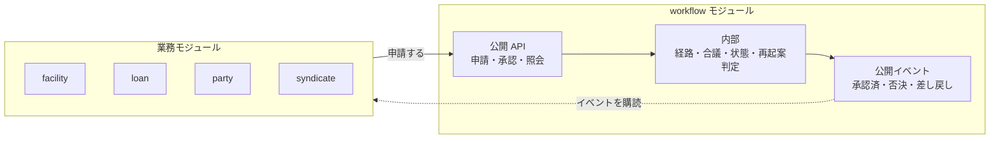

# 設計方針

run-buddy の `backend/CLAUDE.md` と ADR-0004 / ADR-0007 の方針を、本システムに当てはめたもの。

## 1. ドメインモデル

- ドメイン型は不変な `record` か `final` クラスとし、**自分で不変条件を検査する**。setter、引数なしコンストラクタ、永続化用アノテーションを持たせない。
- 値の概念は値オブジェクトにする。例: `Money`(通貨付き金額)、`Percentage`(持分比率)。丸めと合計の一致(NFR-01)はここで守る。
- 業務ルール([BR-xx](../brief/03-business-rules.md))は、検証・計算・状態遷移をドメイン層に置き、単体でテストできるようにする。

### 想定するパッケージ(package by feature)

| パッケージ | 内容 |
|---|---|
| `party` | Company / Borrower / Investor |
| `syndicate` | Syndicate |
| `facility` | Facility / SharePie / FacilityInvestment |
| `loan` | Drawdown / Loan / Payment / PaymentDetail / AmountPie / PaymentDistribution |
| `fee` | FeePayment / FeeDistribution |
| `transaction` | 取引の共通部分と照会 |
| `shared` | Money / Percentage / 共通例外 |
| `persistence` | リポジトリのアダプタ(jOOQ) |
| `web` | REST のコントローラと例外ハンドラ |

依存の向きは `web → ドメイン ← persistence`。ドメインは `web` と `persistence` に依存しない。パッケージ間の依存規則は ArchUnit で検査する。

### ワークフローの独立(NFR-09)

承認ワークフローは、将来、汎用のワークフロー SaaS として切り出す。そのため、最初から**業務と疎結合な独立モジュール `workflow`** として作る(方針案。`/requirements` の後に ADR にする)。

| 規則 | 理由 |
|---|---|
| `workflow` は、業務モジュール(`party`・`syndicate`・`facility`・`loan`・`fee`・`transaction`)のどれにも依存しない | 切り出すときに業務コードを持ち出さない |
| 業務モジュールは、`workflow` の公開 API(Spring Modulith の named interface)だけを使う | 内部の作りを変えても業務側が壊れない |
| 承認の結果は、`workflow` が公開イベント(承認済・否決・差し戻し)を出し、業務モジュールが購読して業務の処理をする。`workflow` が業務のコードを呼び返すことはない | 依存の向きを一方向にする |
| 申請の対象は、`workflow` から見て不透明な参照(種類と ID の文字列)で持つ | 業務のエンティティを知らずに済む |
| 承認経路を決める入力(金額、クレジットスコアなど)は、業務側が「経路属性」として値で渡す。経路の規則(属性と最終決裁の階層の対応)は、組織ごとに `workflow` の中で設定する | 業務ごとの判断基準を、汎用の規則として扱う |
| 否決後の再起案の判定(条件が変わったか)は、業務側が「条件」を値で渡し、`workflow` が前回の値と比べる | 判定の仕組みを汎用にする |
| 組織・職位・承認者の割り当ては、`workflow` が持つ(認証の層から利用者を受け取る) | SaaS として単体で動かせる |
| テナントは組織とする。他の組織の申請は見えない | 各社の稟議が社内で閉じる要件(06)と、SaaS のテナント分離を同じ仕組みで満たす |
| `workflow` のテーブルは専用のスキーマに置き、業務のテーブルへの外部キーを持たない | データごと切り出せる |
| 通知は、`workflow` のイベントを通知の仕組みが受けて送る(07 の通知) | 通知の手段を `workflow` に持ち込まない |

## 2. ポート&アダプタ

- リポジトリはドメイン側のインターフェース(ポート)とし、実装(アダプタ)は `persistence` に置く。
- **ポートに `default` メソッドを置かない**。`@Transactional` のプロキシの外で実行され、実際にバグになった(run-buddy ADR-0007)。ArchUnit のルールで検査する。
- 外部システムとの連携が必要になった場合も、ポートで抽象化し、最初はダミー実装で一通りの流れを確認する(ADR-0004)。

## 3. 永続化

- jOOQ のコード生成物(`persistence/jooq/generated`)は**手で編集しない**。migration を変更したら再生成し、CI で差分を検出する。
- DB アクセスはすべてトランザクション内で行う。アダプタに `@Transactional`(読み取りは `readOnly = true`)を付ける。
- Flyway のマージ済み migration は書き換えず、新しい migration を足す。
- 複数の更新を伴う業務操作(ファシリティ組成、ドローダウン、返済)は、アプリケーション層で単一トランザクションにする。(BR-31)
- 楽観的排他制御は `version` 列で行う。(BR-30)

## 4. 構造テスト(実装より先に書く)

モジュールの境界と設計規則を、**業務の実装より先に**、Spring Modulith と ArchUnit のテストとして書く。最初のユースケースを実装する前に、プロジェクトの骨組みと一緒に作る。

| ツール | 検査すること |
|---|---|
| Spring Modulith(`ApplicationModules.verify()`) | モジュール間の依存が循環しない。他のモジュールの内部(公開 API 以外)を参照しない。`workflow` が業務モジュールに依存しない |
| ArchUnit | モジュールの中の規則。ドメインが `web`・`persistence`(アダプタ)に依存しない。ドメイン型に永続化・Spring のアノテーションを付けない。ドメイン型は `record` か `final`。`@Transactional` なクラスが実装するポートに `default` メソッドを置かない。外部連携のライブラリ(耐障害性、jOOQ など)をドメインで使わない |

- 規則は、モジュールを作る前に、そのモジュールの規則から書く。新しいモジュールや規則を足すときも、構造テストを先に足す。
- 構造テストは、規則に違反するコードを仕込むと失敗することを確かめる(run-buddy のミューテーションチェック)。規則を書いたら、わざと違反させて失敗を見てから戻す。
- 構造テストを弱めて(例外を足して)ビルドを通さない。規則を変えるなら、先に ADR で理由を残す。

## 5. テスト

- テストの正はユースケース仕様(`docs/use_cases/`)。順序は aiup に従い、`/use-case-implement` で実装し、`/use-case-test` でテストを書き、`/use-case-coverage` で抜けを確かめる。仕様と食い違うテストは、コードに合わせて直さず失敗のままにする。
- 業務ルールは、許可される側と拒否される側の両方の境界値をテストする。返済スケジュールなどの計算は、既知の数値例([Share Pie の数値例](../brief/05-share-pie-examples.md) の EX-xx)で、合計が元本と一致することを検査する。
- リポジトリの振る舞いは契約テスト(インターフェースにテストを書き、各アダプタのテストがそれを実装する)で一度だけ定める。新しいメソッドは契約テストから書く。
- DB を使うテストは Testcontainers(PostgreSQL)で行い、他のテストのデータに依存しない。
- REST API 層は、aiup の `spring-rest-test` に従い、実際のサービスと DB を通して(MockMvcTester + Testcontainers)テストする。
- ArchUnit でパッケージ依存・ポートの規則を検査し、規則自体の有効性もミューテーションチェックで確認する。

## 6. 未決事項

- 集約の境界(例: Facility と FacilityInvestment を同一集約にするか、Loan と PaymentDetail をどう束ねるか)。Share Pie は値オブジェクトとし、Facility と Loan がそれぞれ持つことは [ADR-001](decisions/ADR-001-multiple-drawdowns-and-loan-share-pie.md) で決定済み。
- Transaction の継承階層(ddd-ai は JPA の継承)を、ドメインでは sealed interface と record で表すか。
- ドメインイベント(ddd-ai の Spring Events による連携)を導入するか、アプリケーション層の明示的な呼び出しにするか。
- 状態遷移と複数集約にまたがる更新(ファシリティ組成時の Borrower / Investor の RESTRICTED 化)の置き場所。

これらは決まった時点で ADR に記録する。
