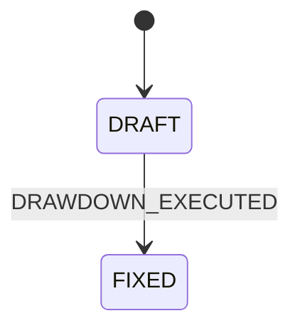
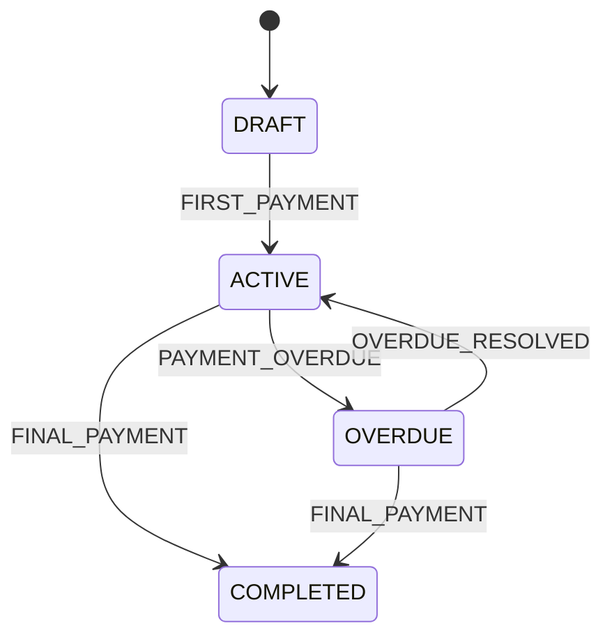
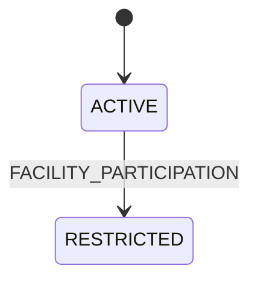

# 業務ルール

## 1. 入力検証

| ID | ルール | 違反時 |
|---|---|---|
| BR-01 | 参照するシンジケート・投資家・ファシリティ・借り手が存在すること。 | 404 |
| BR-02 | 投資家はアクティブであること(ファシリティ組成時)。 | 400 |
| BR-03 | Facility の Share Pie(投資家ごとのコミットメント額)の合計は、Facility のコミットメント額と一致すること(比率にすれば合計 100%)。 | 400 |
| BR-04 | ドローダウン金額は 1 円以上で、Facility の利用可能額以下であること。 | 400 |
| BR-05 | 金利は 0 以上、返済期間は 1 以上であること。 | 400 |
| BR-06 | ファシリティ組成時の投資家は、シンジケートのメンバーであること。 | 400 |

## 2. 返済スケジュールの計算

月次(`MONTHLY`)を基本とする。月利 `r = 年利 ÷ 12`、回数 `n = 返済期間(月)`、元本 `P`。

### BR-10 元利均等返済(EQUAL_INSTALLMENT)

毎回の支払額(元本+利息)を一定にする。

- 毎回の支払額 = `P × r × (1+r)^n ÷ ((1+r)^n − 1)`
- 各回の利息 = `残高 × r`
- 各回の元本 = `支払額 − 利息`
- 残高 = `残高 − 元本`

### BR-11 バレット返済(BULLET_PAYMENT)

- 期間中は利息のみを支払う: 毎回の利息 = `P × r`
- 最終回に元本を全額返済する。

### BR-12 返済時の配分

- 元本・利息とも、支払い時点の **Loan の Share Pie** で按分する(Facility の Share Pie ではない)。
- 元本分と利息分を別々に配分する。
- 元本分のみ Loan の Share Pie から引く。利息では Loan の Share Pie は変わらない。
- 元本の返済額は Loan の元本残高以下であること。

### BR-13 按分と端数

- 按分は、各投資家の正確な値(金額 × 持分 ÷ 合計)を最小通貨単位(JPY は 1 円)に切り捨て、残った端数を **最大剰余方式**で配る。
- 端数は、切り捨てた小数部の大きい投資家から 1 単位ずつ配る。小数部が同じなら持分の大きい順、それも同じなら投資家 ID の順とする。
- 配分の合計は、按分する金額と必ず一致する。
- 持分の合計が 0 の Share Pie では按分できない(業務エラー)。

### BR-14 ドローダウンの配分の明示指定

- 配分の合計は引き出し額と一致すること。
- 各投資家の配分は 0 以上であること(0 は辞退を表す)。
- 配分先は、その Facility の Share Pie にいる投資家に限る。

## 3. 状態遷移

状態遷移により、不正な状態変更(例: 引き出し後の持分の変更)を業務ルールとして阻止する。

### BR-21 Facility

| 状態 | 意味 | 制約 |
|---|---|---|
| DRAFT | 作成直後 | Share Pie を変更できる。 |
| FIXED | 初回のドローダウン実行後 | Facility の Share Pie とコミットメント額の変更を禁止。**ドローダウンは利用可能額の範囲で何度でもできる。** |

遷移は初回のドローダウンでのみ起こる。2回目以降は FIXED のまま。

遷移トリガー: ドローダウン実行時に自動発火する。

### BR-22 Loan

| 状態 | 意味 |
|---|---|
| DRAFT | ドローダウン直後。返済スケジュール生成済み、返済未開始。 |
| ACTIVE | 期日どおりに返済が続いている。 |
| OVERDUE | 返済期日を過ぎても未返済。延滞管理が必要。 |
| COMPLETED | 元本・利息の返済が完了し、残高ゼロ。 |

| トリガー | 発火条件 |
|---|---|
| FIRST_PAYMENT | 初回の元本または利息の支払い時 |
| PAYMENT_OVERDUE | 返済期日を過ぎても未返済 |
| OVERDUE_RESOLVED | 遅延していた支払いを実行した |
| FINAL_PAYMENT | すべての元本・利息の返済が完了 |

### BR-23 Borrower / Investor

| 状態 | 制約 |
|---|---|
| ACTIVE | 基本情報を変更できる。 |
| RESTRICTED | 基本情報の変更を制限する(ファシリティ参加により重要データの整合性を保護)。 |

ファシリティ組成時に、借り手と、その Share Pie に含まれる全投資家を ACTIVE → RESTRICTED に遷移させる。

## 4. データ整合性

| ID | ルール |
|---|---|
| BR-30 | 集約ルートの更新は楽観的排他制御(バージョン)とし、競合は業務エラーとして返す。 |
| BR-31 | ファシリティ組成(Facility・Share Pie・Facility Investment の作成)は単一トランザクションで行い、失敗時はすべて取り消す。 |
| BR-32 | 金額は通貨付きの値として扱い、丸め誤差を生じさせない精度で計算する。 |

## 5. 手数料

### 手数料の種類

| 種別 | 受益者 | 計算基準 | 配分 | 発生タイミング |
|---|---|---|---|---|
| MANAGEMENT_FEE(管理手数料) | リード銀行 | 融資枠残高 × 料率 | 単一受益者 | 定期(月次・四半期) |
| ARRANGEMENT_FEE(アレンジメント手数料) | リード銀行 | 融資枠設定額 × 料率 | 単一受益者 | シンジケート組成時 |
| COMMITMENT_FEE(コミットメント手数料) | 投資家 | 未使用残高 × 料率 | 持分比率ベース | 定期(月次) |
| TRANSACTION_FEE(取引手数料) | エージェント銀行 | 取引件数・金額ベース | 単一受益者 | 取引実行時 |
| LATE_FEE(遅延手数料) | 投資家 | 遅延金額 × 料率 × 日数 | 持分比率ベース | 遅延発生時 |
| AGENT_FEE(エージェント手数料) | エージェント銀行 | 定額または料率 | 単一受益者 | 定期(月次) |
| OTHER_FEE(その他) | 任意 | 個別設定 | 個別設定 | 不定期 |

### ルール

| ID | ルール |
|---|---|
| BR-40 | 手数料額 = 計算基準額 × 手数料率 ÷ 100。入力された手数料額と計算結果が整合すること。 |
| BR-41 | 手数料日付は未来日不可。 |
| BR-42 | 受益者タイプは種別に整合すること。MANAGEMENT / ARRANGEMENT / TRANSACTION / AGENT はリード銀行(またはエージェント銀行)のみ。COMMITMENT / LATE は投資家のみ。OTHER は任意。 |
| BR-43 | 投資家配分型(COMMITMENT / LATE)は、**Facility の Share Pie** で各投資家へ按分する(BR-13)。Loan の Share Pie は使わず、Loan も変わらない。 |
| BR-44 | 単一受益者型は、指定された受益者へ 100% 配分する。 |
| BR-45 | 手数料は投資家の現在投資額に影響させない。 |

## 要確認

- **Loan の状態(BR-22)と複数回の引き出し**: COMPLETED の後に再び引き出せるか。返済スケジュールを引き出しごとに持つ場合、OVERDUE を Loan 全体で判定するか。
- **BR-13 の端数規則**: 最大剰余方式は本書の提案。業務上の慣行があれば差し替える。
- **BR-43 の手数料配分**: 書籍は、Facility を利用可能にしておく対価の手数料を **Facility の持分**で配分する。ddd-ai は、コミットメント・遅延のみを Share Pie で配分している。管理・アレンジメント・エージェント手数料の扱いは、別の性質の報酬として整理する。

- **手数料の種類の食い違い**: 業務概要(元ネタの要件文書)は「コミットメント / アレンジメント / エージェント / 参加フィー / 早期返済手数料 / 年間管理手数料」を挙げ、機能仕様は上表の7種を定義している。上表を暫定の正とし、**参加フィー(Participation Fee)・早期返済手数料(Prepayment Fee)は未定義**のため、要否を決める。
- **「年間管理手数料」と「管理手数料(MANAGEMENT_FEE)」は同一か**。
- **エージェント手数料の受益者**: 業務概要では「リード銀行など」、機能仕様では「エージェント銀行のみ」。リード銀行とエージェント銀行を別の役割として持つかを決める。
- 遅延手数料の日数計算の基準(暦日 / 営業日、日割りの分母)。
