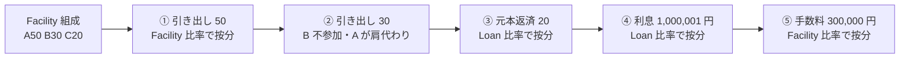

# Share Pie の数値例とテストケース

[ADR-0001](../adr/0001-multiple-drawdowns-and-loan-share-pie.md) の決定(複数回のドローダウンを許し、Loan に Share Pie を持たせる)を、具体的な数値で示す。
筋書きは Evans『Domain-Driven Design』第8章の例(2回目の引き出しで貸し手 B が参加しない)にならう。金額はこのリポジトリ独自の例である。

この文書の数値は、そのまま単体テストの期待値にする(第3節)。

## 1. Share Pie とは(このシステムでの定義)

**Share Pie = 投資家ごとの持分を「金額」で持つ値オブジェクト。** 比率は金額から導出する。

- Facility の Share Pie: 各投資家のコミットメント額。合計 = Facility のコミットメント額。
- Loan の Share Pie: 各投資家が実際に貸している元本。合計 = Loan の元本残高。
- 支払いの配分(Payment Distribution / Fee Distribution / ドローダウンの配分)も Share Pie で表す。

比率ではなく金額で持つのは、引き出しや返済で持分が独立に動いても、足し算・引き算で正確に追えるようにするためである。比率で持つと、ずれを Loan Adjustment のような補正で追うことになり、書籍が指摘した端数の不整合が起きる。

### 操作(shares math)

| 操作 | 意味 | 使う場面 |
|---|---|---|
| `prorate(金額)` | 自分の比率で金額を按分し、新しい Share Pie を返す(端数は BR-13) | 引き出しの配分、元本・利息・手数料の配分 |
| `plus(pie)` | 投資家ごとに足す | 引き出しで Loan の持分を増やす |
| `minus(pie)` | 投資家ごとに引く。負になる投資家があれば業務エラー | 元本返済で Loan の持分を減らす |
| `total()` | 合計 | 残高・上限の検査 |
| `ratioOf(投資家)` | 比率(導出値。表示用) | 画面・レポート |

## 2. 通しの例

### 前提

- Facility: コミットメント 100,000,000 円、通貨 JPY。
- 投資家 A・B・C。Facility の Share Pie は次のとおり。

| 投資家 | Facility の持分 | 比率 |
|---|---:|---:|
| A | 50,000,000 | 50% |
| B | 30,000,000 | 30% |
| C | 20,000,000 | 20% |
| 合計 | 100,000,000 | 100% |

### 手順と結果

(単位: 図は百万円、表は円)

**① 1回目の引き出し 50,000,000 円(配分の指定なし → Facility の比率で按分)**

| 投資家 | 引き出しの配分 | Loan の持分(後) |
|---|---:|---:|
| A | 25,000,000 | 25,000,000 |
| B | 15,000,000 | 15,000,000 |
| C | 10,000,000 | 10,000,000 |
| 合計 | 50,000,000 | 50,000,000 |

Loan が作られる。Facility は FIXED になる(持分の変更は不可。引き出しは引き続き可能)。利用可能額 = 50,000,000。

**② 2回目の引き出し 30,000,000 円(配分を明示: B は参加せず、A が B の分を肩代わり)**

Facility の比率どおりなら A 15,000,000 / B 9,000,000 / C 6,000,000 だが、B が辞退し A が引き受けた。

| 投資家 | 引き出しの配分 | Loan の持分(後) | Loan の比率 | Facility の比率 |
|---|---:|---:|---:|---:|
| A | 24,000,000 | 49,000,000 | 61.25% | 50% |
| B | 0 | 15,000,000 | 18.75% | 30% |
| C | 6,000,000 | 16,000,000 | 20.00% | 20% |
| 合計 | 30,000,000 | 80,000,000 | 100% | 100% |

**ここが要点**: Loan の比率は Facility の比率から離れる。Loan Adjustment のような補正は持たず、Loan の Share Pie に引き出しの配分を `plus` するだけで表す。利用可能額 = 20,000,000。

**③ 元本返済 20,000,000 円(Loan の比率で按分)**

| 投資家 | 元本の配分 | Loan の持分(後) |
|---|---:|---:|
| A | 12,250,000 | 36,750,000 |
| B | 3,750,000 | 11,250,000 |
| C | 4,000,000 | 12,000,000 |
| 合計 | 20,000,000 | 60,000,000 |

Facility の比率(50/30/20)で配分すると、B は 6,000,000 円を受け取ることになる。B が実際に貸しているのは 15,000,000 円なので、貸した額に比べて多く受け取り、A は少なく受け取ってしまう。

**④ 利息 1,000,001 円(Loan の比率で按分。Loan の持分は変わらない)**

| 投資家 | 正確な値 | 切り捨て | 端数の配分 | 配分 |
|---|---:|---:|---:|---:|
| A | 612,500.6125 | 612,500 | +1 | 612,501 |
| B | 187,500.1875 | 187,500 | | 187,500 |
| C | 200,000.2 | 200,000 | | 200,000 |
| 合計 | 1,000,001 | 1,000,000 | 1 | 1,000,001 |

端数の1円は、小数部が最も大きい A に配る(BR-13)。

**⑤ 手数料(コミットメント手数料)300,000 円(Facility の比率で按分。Loan は変わらない)**

| 投資家 | 配分 |
|---|---:|
| A | 150,000 |
| B | 90,000 |
| C | 60,000 |

B は②で貸していないが、Facility の持分に応じて手数料を受け取る。手数料は「Facility を利用可能にしておく対価」だからである。

**⑥ 全額返済 60,000,000 円**

配分は Loan の持分そのもの(A 36,750,000 / B 11,250,000 / C 12,000,000)になり、Loan の持分はすべて 0 になる。Loan は COMPLETED になる。

## 3. テストケース

各ケースはドメイン層の単体テスト(DB なし)にする。テスト名にケース ID を含める。
「前提」の列の番号は第2節の手順を指す(例: 「②の後」= Loan の持分 A 49,000,000 / B 15,000,000 / C 16,000,000)。

### 3.1 Share Pie の演算

| ID | 前提 | 操作 | 期待結果 |
|---|---|---|---|
| TC-01 | Pie A50,000,000 / B30,000,000 / C20,000,000 | `prorate(50,000,000)` | A25,000,000 / B15,000,000 / C10,000,000 |
| TC-02 | 同上 | `prorate(10,000,001)` | A5,000,001 / B3,000,000 / C2,000,000(端数1円は小数部 0.5 の A) |
| TC-03 | Pie A1 / B1 / C1 | `prorate(100)` | A34 / B33 / C33(小数部も持分も同じなので投資家 ID 順) |
| TC-04 | ②の後の Loan | `prorate(1,000,001)` | A612,501 / B187,500 / C200,000 |
| TC-05 | 任意の Pie と金額 | `prorate(x)` | 合計 = x。各投資家の値は正確な値の切り捨て以上・切り上げ以下 |
| TC-06 | 持分がすべて 0 の Pie | `prorate(1)` | 業務エラー(按分できない) |
| TC-07 | ①の後の Loan | `plus(A24,000,000 / B0 / C6,000,000)` | A49,000,000 / B15,000,000 / C16,000,000、合計 80,000,000 |
| TC-08 | ③の後の Loan | `minus(A36,750,001 / B11,250,000 / C12,000,000)` | 業務エラー(A が負になる) |
| TC-09 | Pie | 通貨の異なる Pie や金額との演算 | 業務エラー |

TC-05 は、数値例のテストに加えて、ランダムな入力で性質を検査するテスト(プロパティベーステスト)にもする。ライブラリは未決。

### 3.2 ドローダウン

| ID | 前提 | 操作 | 期待結果 |
|---|---|---|---|
| TC-11 | Facility 組成直後(DRAFT) | 50,000,000 を配分指定なしで引き出す | 配分 A25,000,000 / B15,000,000 / C10,000,000。Loan が作られ、持分は配分と同じ。Facility は FIXED |
| TC-12 | ①の後(FIXED) | 30,000,000 を A24,000,000 / B0 / C6,000,000 と指定して引き出す | 成功(**2回目の引き出しを許す**)。Loan の持分は A49,000,000 / B15,000,000 / C16,000,000 |
| TC-13 | ②の後(利用可能額 20,000,000) | 20,000,000 を引き出す | 成功(境界値: 利用可能額ちょうど)。Loan の持分の合計は 100,000,000 |
| TC-14 | ②の後(利用可能額 20,000,000) | 20,000,001 を引き出す | 業務エラー(利用可能額超過、BR-04)。Loan は変わらない |
| TC-15 | ①の後 | 配分の合計が引き出し額と違う(30,000,000 に対して合計 29,999,999) | 業務エラー(BR-14) |
| TC-16 | ①の後 | 配分に負の値を含む | 業務エラー(BR-14) |
| TC-17 | ①の後 | Facility の Share Pie にいない投資家 D に配分する | 業務エラー(BR-14) |
| TC-18 | ①の後 | 0 円を引き出す | 業務エラー |
| TC-19 | FIXED の Facility | Facility の Share Pie を変更する | 業務エラー(BR-21) |

### 3.3 元本返済・利息・手数料

| ID | 前提 | 操作 | 期待結果 |
|---|---|---|---|
| TC-21 | ②の後 | 元本 20,000,000 を返済 | 配分 A12,250,000 / B3,750,000 / C4,000,000。Loan の持分 A36,750,000 / B11,250,000 / C12,000,000 |
| TC-22 | ②の後 | 元本返済の配分を検査 | Facility の比率(A10,000,000 / B6,000,000 / C4,000,000)では**ない**こと |
| TC-23 | ③の後 | 利息 1,000,001 を支払う | 配分 A612,501 / B187,500 / C200,000。Loan の持分は変わらない |
| TC-24 | ②の後 | 手数料 300,000 を支払う | 配分 A150,000 / B90,000 / C60,000(Facility の比率。②で貸していない B にも配る)。Loan の持分は変わらない |
| TC-25 | ③の後(残高 60,000,000) | 元本 60,000,000 を返済 | 配分は Loan の持分と同じ。Loan の持分はすべて 0。Loan は COMPLETED |
| TC-26 | ③の後(残高 60,000,000) | 元本 60,000,001 を返済 | 業務エラー(残高超過)。Loan は変わらない |
| TC-27 | ③の後 | 利用可能額を求める | 未決(要確認1)。回転型なら 40,000,000、非回転型なら 20,000,000 |

### 3.4 不変条件(どの操作の後でも成り立つこと)

| ID | 不変条件 |
|---|---|
| TC-31 | Loan の Share Pie の合計 = Loan の元本残高 |
| TC-32 | 各支払いの配分の合計 = 支払額(1円の過不足もない) |
| TC-33 | Loan の Share Pie の各投資家の値は 0 以上 |
| TC-34 | Facility の Share Pie の合計 = コミットメント額。FIXED の後は変わらない |
| TC-35 | Loan の元本残高 ≦ Facility のコミットメント額 |

## 要確認

1. **利用可能額の計算(回転型か否か)**: 書籍はクレジットカードにたとえており、返済すれば再び借りられる回転型(リボルビング)と読める。その場合、利用可能額 = コミットメント − 元本残高。非回転型(タームローン)なら、利用可能額 = コミットメント − 引き出し累計。TC-27 の期待値が変わる。
2. **投資家ごとの上限**: ドローダウンで配分を明示するとき、ある投資家の Loan の持分が、その投資家の Facility の持分を超えてよいか(例: ②で A の持分 49,000,000 は Facility の 50,000,000 以内。さらに引き受けると超える)。書籍は言及していない。
3. **返済スケジュール**: Loan を Facility ごとに1つとし、引き出しのたびに持分が増えるモデルでは、返済スケジュール(BR-10, BR-11)を引き出しごとに作るか、Loan 全体で作るかを決める必要がある。
4. **COMPLETED の後の引き出し**: 全額返済した Loan に、再び引き出しを積めるか(回転型なら可能)。
5. **端数の配分規則(BR-13)**: 最大剰余方式は本書の提案である。業務上の慣行(例: 端数はリード銀行に寄せる)があれば差し替える。
