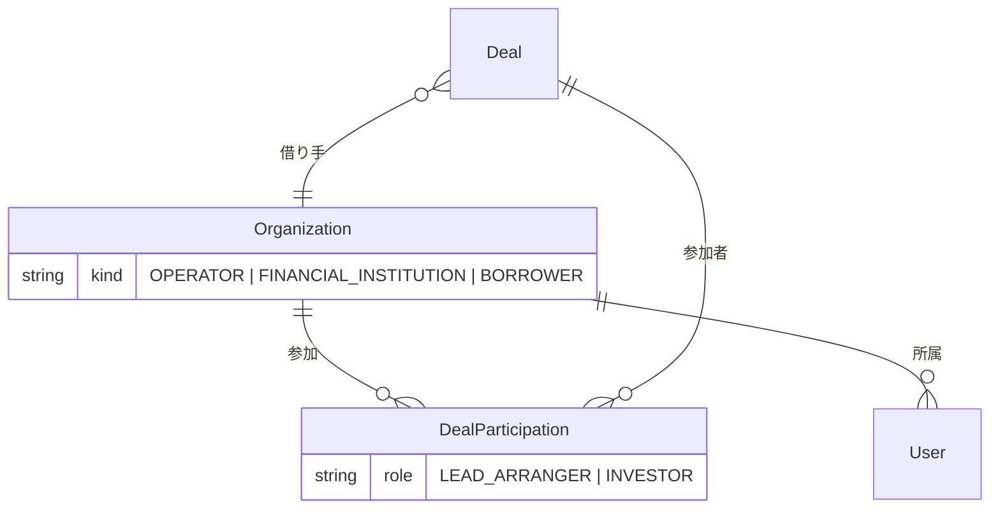
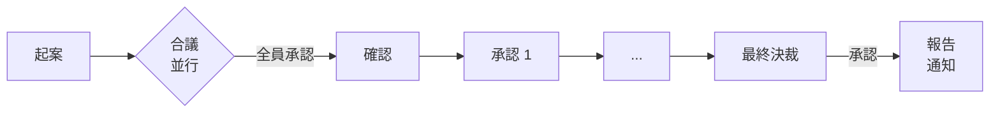
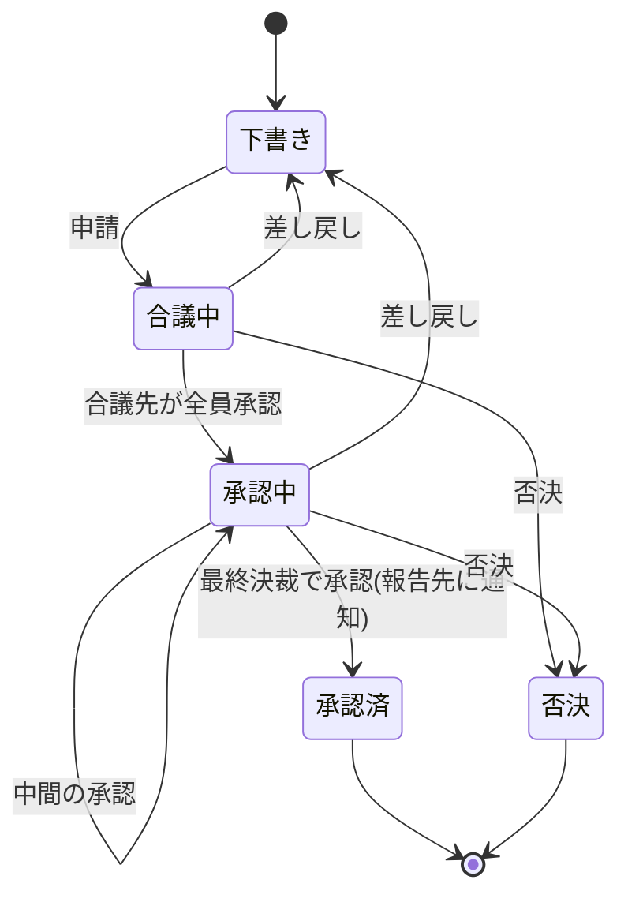

# アクター・ロールと承認ワークフロー

GitHub の Issue #6(ワークフロー)と #7(認証認可)の骨格。2026-11-10 に決定した事項をまとめる。

## 1. アクター

本システムは、シンジケートローンのリード銀行(アレンジャー)になりうる会社が、**SPC(Special Purpose Company、特別目的会社)** を作って運営する。

| アクター | 立場 | できること |
|---|---|---|
| 運営 SPC | システムを運営する会社 | **運用だけ**(利用組織の登録、システム設定、監視)。他社の案件データ(借り手の情報、各社の稟議など)は見ない |
| リード銀行(アレンジャー) | 利用組織(金融機関)の、案件での立場 | シンジケートの呼びかけ、出資者の管理、借り手と出資者の**審査**、社内の承認ワークフロー |
| 出資者 | 利用組織(金融機関)の、案件での立場 | 案件の採算性とリスクの判断(第5節の開示情報による)、社内の承認ワークフロー。**審査機能は使えない** |
| 借り手 | 利用組織(企業) | 融資の申し込み、残高と返済予定表の照会。**借り手の業務フローはスコープ外** |

### 立場は案件単位

金融機関は、案件ごとにリード銀行にも出資者にもなりうる。そのため、**「リード銀行」「出資者」は会社の属性ではなく、案件での立場**として持つ。審査機能を使えるかは、その案件での立場で決まる。

## 2. ロール

権限は、次の3つの組み合わせで決まる。

| 軸 | 内容 | 決める人 |
|---|---|---|
| 組織の種別 | 運営 SPC / 金融機関 / 借り手 | 運営 SPC(組織の登録時) |
| 案件での立場 | リード銀行 / 出資者(金融機関のみ) | 案件の組成時 |
| 組織内のロールと職位 | 下表 | **各社の組織管理者** |

### 組織内のロール

| 組織 | ロール | 内容 |
|---|---|---|
| 運営 SPC | 運用管理者 | 利用組織の登録、システム設定。案件データは見ない |
| 金融機関 | 組織管理者 | 自社のユーザー、職位、承認経路の規則を設定する |
| 金融機関 | 業務ユーザー | 職位(第3節)を持ち、起案・確認・承認・合議を行う |
| 借り手 | 申込可 | 申し込みと照会 |
| 借り手 | 照会のみ | 残高と返済予定表の照会 |

## 3. 承認ワークフロー(稟議)

リード銀行と出資者は、それぞれ**自社の中で**稟議を回す。他社の稟議は見えない。

この承認ワークフローは、将来、汎用のワークフロー SaaS として切り出して販売する(NFR-09)。そのため、以下の合議・メイントラック・報告・差し戻し・否決・再起案の規則は、シンジケートローンに限らない汎用の機能として扱う。「稟議にかける業務」の表は、汎用のワークフローを本システムがどう使うかの定義である。

### 稟議にかける業務

| 立場 | 稟議の種類 | 承認されると |
|---|---|---|
| リード銀行 | 借り手審査 | 借り手の融資案件を進められる |
| リード銀行 | 出資者審査 | その出資者をシンジケートに招ける |
| リード銀行 | シンジケートの呼びかけ | 出資者へ参加を呼びかける |
| リード銀行 | ファシリティ組成 | Facility と Share Pie が確定する |
| 出資者 | 出資の参加判断 | シンジケートへの参加と、Facility の持分を応諾する |
| 出資者 | ドローダウンの拠出 | 引き出しへの拠出(応諾・辞退・肩代わりの金額)を回答する。回答はドローダウンの配分(BR-14)になる |

### 承認経路

- 職位は、弱い順に並ぶ階層とする(例: 起案担当 → 確認者 → 部長 → 事業部長 → 本部長 → 取締役会)。呼び方は各社が決める。
- **データモデル上は階層数を制限しない。UI は起案・確認を含めて5階層までを考慮する。**
- 稟議ごとに、金額と借り手の信用状況(クレジットスコアなど)から、必要な最終決裁の階層を決める。この規則は各社の組織管理者が設定する。

### 流れ

1. **合議**: 合議先が**並行**で審議する。**全員が承認したら**、メイントラックに乗る。
2. **メイントラック**: 確認者から最終決裁者まで、**下から上へ順に**承認する。
3. **報告**: 最終決裁で承認されたら、報告先に**通知**する。報告先は閲覧だけで、操作はしない。

### 状態

| 操作 | 結果 |
|---|---|
| 差し戻し | **振り出しに戻る**。起案者が修正して再申請する。再申請では合議からやり直す |
| 否決 | **その稟議は再申請できない**(終端)。融資案件そのものは止まらず、必要なら別の稟議を新しく起案できる |

**否決後の再起案**: 否決された稟議と**同じ内容での再起案はできない**。**条件を変えた場合に限り**、新しい稟議として起案できる。システムは、否決された稟議と比べて判断に関わる項目(例: 金額、金利、期間、償還条件、配分)が1つも変わっていなければ、起案を受け付けない。

## 4. 機能と権限

| 機能 | 運営 SPC | リード銀行 | 出資者 | 借り手(申込可) | 借り手(照会のみ) |
|---|:-:|:-:|:-:|:-:|:-:|
| 利用組織の登録 | ○ | | | | |
| 自社のユーザー・職位・承認経路の設定 | | ○(組織管理者) | ○(組織管理者) | | |
| 融資の申し込み | | | | ○ | |
| 残高・返済予定表の照会 | | ○ | ○(自社の持分) | ○ | ○ |
| 借り手・出資者の審査 | | ○ | | | |
| シンジケートの呼びかけ・出資者の管理 | | ○ | | | |
| 案件の採算性・リスクの判断(開示情報) | | ○ | ○ | | |
| 社内の稟議(起案・合議・承認) | | ○ | ○ | | |
| 他社の案件データ・稟議の閲覧 | | | | | |

## 5. 出資者への開示情報

出資者が採算性とリスクを判断するため、リード銀行は次の情報を開示する。審査の詳細は開示しない。

| 開示情報 | 内容 |
|---|---|
| 借り手の公開情報サマリー | 公開されている企業情報の要約 |
| 案件主旨 | 融資の目的・背景 |
| クレジットスコア | 借り手の信用度の指標 |
| 償還条件 | 期間、返済方法、金利など |
| IRR | 出資者から見た内部収益率 |

## 要確認

未決事項は GitHub Issue で管理する。決まったら本文に反映し、ここから消す。

* [#10 合議先の単位と、合議での否決・差し戻し](https://github.com/tis-abe-akira/ddd-syndicate-loan/issues/10)
* [#11 稟議の取り下げ・代理承認・階層の飛ばし](https://github.com/tis-abe-akira/ddd-syndicate-loan/issues/11)
* [#12 否決後の再起案で「条件を変えた」と判定する項目](https://github.com/tis-abe-akira/ddd-syndicate-loan/issues/12)
* [#13 報告・通知の手段](https://github.com/tis-abe-akira/ddd-syndicate-loan/issues/13)
* [#14 クレジットスコアと IRR の出所・計算](https://github.com/tis-abe-akira/ddd-syndicate-loan/issues/14)
* [#15 借り手の申し込みの内容と受付先](https://github.com/tis-abe-akira/ddd-syndicate-loan/issues/15)
* [#16 運営 SPC が障害調査で案件データに触れる場合の扱い](https://github.com/tis-abe-akira/ddd-syndicate-loan/issues/16)
