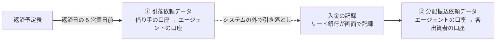

# 外部システム連携

GitHub の Issue #8 の要件。2026-11-10 に決定した事項をまとめる。

## 1. 連携先の区分

| 区分 | 範囲 | 性質 |
|---|---|---|
| 自社の他サービス | **運営 SPC のグループのサービスだけ** | 仕様を相談・変更できる。障害時の連絡経路がある |
| 他社のサービス | グループ外の事業者のサービス | 仕様は相手が決める。変更・障害を制御できない |

**利用各社(リード銀行・出資者・借り手)の社内システムとは連携しない。** 各社が必要とするデータは、ファイルの出力(第3節の会計向け CSV、振替依頼データ)で渡す。

## 2. 送金は記録だけ

ドローダウンの資金、返済・利息・手数料の配分について、**システムは記録だけを行い、実際の送金・決済は行わない。** 送金は各社がシステムの外で行う。振替依頼データ(第3節)は、そのための依頼ファイルを作るだけである。

## 3. 連携先と方式

| 連携先 | 方式 | 区分 | 実装 |
|---|---|---|---|
| ID プロバイダ | フロントエンドとバックエンドの間に認証の層を1つ挟み、**ID プロバイダを差し替えられる**ようにする | 未決 | 候補: 簡易な自作、Keycloak |
| 通知 | **各ユーザーの Web 画面にお知らせが届く方式を主とする。** メール・チャットを将来追加できるよう、送り先の手段を差し替え・追加できる作りにする | 内部 | 画面内のお知らせ |
| 営業日カレンダー | **日本の銀行営業日**。システム内部にカレンダーを持つ簡易な実装でよい | 内部 | 内部のカレンダー |
| 企業の公開情報 | **連携しない。** 借り手の申し込み時に、リンクやファイルを添付する | — | 添付 |
| 信用格付 | 外部システムから取得する | 他社 | **モック** |
| 金利指標 | 外部システムから取得する | 他社 | **モック** |
| 会計 | キャッシュフローと摘要欄の **CSV をダウンロード**できればよい | — | ファイル出力 |
| 振替依頼データ | **バッチで、銀行に出す振替依頼用のデータを作る**(第4節) | — | Spring Batch |
| 資金決済・送金 | 対象外(第2節) | — | — |

### 補足

- **ID プロバイダ**: 認証は標準(OpenID Connect / OAuth 2.0)で受け、ID プロバイダ固有の処理を認証の層に閉じ込める。ロールや職位(06 の第2節)は本システムが管理するか、ID プロバイダに持たせるかは要確認。
- **通知**: 「お知らせ」をドメインの概念とし、送り先の手段(画面、メール、チャット)はポートの実装として増やす。報告・合議依頼・承認依頼・差し戻し・否決・出資者への呼びかけが通知の対象になる(#13)。
- **営業日**: 土日・祝日・年末年始(12/31〜1/3)を休業日とする。祝日データの保守は運営 SPC の運用で行う(案)。
- **信用格付・金利指標**: 外部システムとしてポートとアダプタを作り、アダプタの先をモックにする。モックは、遅延・エラー・タイムアウトを起こせるようにし、第4節の技術検証に使う。

## 4. 振替依頼データ

リード銀行がエージェントとして、借り手からお金を集め、出資者に配る。システムは依頼ファイルを作るだけで、ファイルはリード銀行がダウンロードし、システムの外で銀行に出す。

| データ | 内容 | 形式 | 金額 |
|---|---|---|---|
| ① 引落依頼 | 返済日の元本・利息・手数料を、借り手の口座から引き落とす | 全銀協規定の**口座振替**(種別コード 91) | 返済予定表の額 |
| ② 分配振込依頼 | 入金を記録した額を、各出資者の口座へ振り込む | 全銀協規定の**総合振込**(種別コード 21) | 元本・利息は Loan の Share Pie、手数料は Facility の Share Pie で按分(BR-12, BR-13, BR-43) |

**入金の記録**: リード銀行の担当者が画面で記録する。銀行が返す振替結果ファイルの取り込みは、将来の課題とする。

### 全銀協規定フォーマットの概要

金融機関の公開資料[^yamanashi-zengin][^shinkin-zengin][^mufg-bizstn]による。全銀協の原典は未確認。

- 1ファイルは、ヘッダー(データ区分 1)・データ(2)・トレーラ(8)・エンド(9)の4種類のレコードからなる。
- 各レコードは 120 バイトの固定長。文字コードは JIS が基本で、金融機関によっては EBCDIC にも対応する。
- トレーラには、データレコードの合計件数(6桁)と合計金額(12桁)を、右詰め・ゼロ埋めで入れる。
- 項目の必須・任意、文字種(半角カナなど)、日付の書式、改行コードの扱いは金融機関ごとに異なる。出力先の銀行の仕様に合わせられるようにする。

### ルール

| ID | ルール |
|---|---|
| BR-50 | 振替日は銀行営業日とする。休日に当たる場合は翌営業日にする(内部の営業日カレンダーを使う)。 |
| BR-51 | ①は、返済日の **5 営業日前**に作る。返済日が休日なら、BR-50 で調整した後の振替日から数える。 |
| BR-52 | トレーラの合計件数・合計金額は、データレコードの件数・金額の合計と一致する。 |
| BR-53 | ②の合計金額は、記録した入金額と一致する。0円の配分はデータレコードにしない。 |
| BR-54 | ②は、入金額が予定額と一致した場合に作る。不足した場合は作らず、Loan を遅延(OVERDUE)として扱う。 |
| BR-55 | 同じ振替日・同じ対象で再実行しても、依頼データを二重に作らない。 |
| BR-56 | 借り手と出資者は、銀行口座の情報(金融機関コード、支店コード、預金種目、口座番号、カナの口座名義)を持つ。口座名義は全銀の文字種(半角カナ等)に変換できること。 |

### Spring Batch で検証すること

- チャンク処理(一定件数ずつ読み書きする)
- 失敗した位置からの再開
- 再実行での冪等性(BR-55)
- Facility ごとの分割処理
- 固定長ファイルの書き出しと、トレーラの合計(BR-52)の検証

## 5. 技術検証を兼ねる

外部連携は、次の技術の検証も目的とする。

| 技術 | 検証の対象 |
|---|---|
| リトライ | 他社のサービス(信用格付・金利指標)の一時的な失敗 |
| サーキットブレーカー | 他社のサービスの障害が続く場合に、呼び出しを止めて、システム全体を巻き込まないこと |
| タイムアウト | 他社のサービスの遅延 |
| Spring Batch | 振替依頼データの作成(第4節) |

検証は、モックで障害を再現する自動テストで行う(例: 3回失敗した後に成功する、障害が続いてサーキットが開く、時間が経って閉じる)。

## 6. 設計方針

- 連携先ごとに、ドメイン側にポート(インターフェース)を置き、アダプタで実装する([設計方針](../architecture/design-principles.md) 第2節)。
- 他社のサービスとの間には、相手のモデルがドメインに入り込まないよう、変換を担う層(腐敗防止層)を挟む。
- リトライ・サーキットブレーカーはアダプタ側に置き、ドメインには持ち込まない。
- 外部の呼び出しは、データベースのトランザクションの中で行わない。

## 要確認

- **振替依頼データ**: 出力先の銀行(エージェントの取引銀行)の仕様の違いを、どこまで設定で吸収するか。一部入金の按分(BR-54 で将来の課題とした)。
- **口座情報の扱い**: 口座番号などの機微な情報の保護(暗号化、閲覧できるロール)。
- **認証の層の作り**: BFF(Backend for Frontend)やゲートウェイとするか、バックエンド内の部品とするか。
- **ロール・職位の管理場所**: 本システムか、ID プロバイダか。
- **添付ファイルの保存先**: データベースか、オブジェクトストレージか。容量の上限。
- **会計向け CSV の項目**: キャッシュフローの粒度(取引ごとか、日ごとか)、摘要欄の内容、出力の範囲(自社の持分だけか)。
- **リトライ・サーキットブレーカーのライブラリ**: 候補は Resilience4j、Spring Framework の標準機能。[技術スタック](../architecture/tech-stack.md) で決める。
- **変動金利**: 金利指標を使う変動金利のローンを、要件(返済スケジュールの計算 BR-10, BR-11)に入れるか。

[^yamanashi-zengin]: yamanashi-zengin
[^shinkin-zengin]: shinkin-zengin
[^mufg-bizstn]: mufg-bizstn
