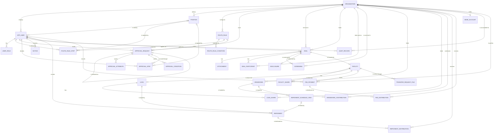

# Entity Model

シンジケートローン管理システムのエンティティモデル。入力は [要件カタログ](requirements.md)、[用語集](glossary.md)、[docs/brief/](brief/index.md)、ADR-001〜003。

モジュールの持ち主(ADR-002・003): ORGANIZATION・APP_USER・USER_ROLE・POSITION は `organization`、ROUTE_RULE〜APPROVAL_STEP は `workflow`、NOTICE は通知、それ以外は業務のモジュール。業務のエンティティは稟議を `approval_request_id` で参照するが、外部キーは張らない(`workflow` をデータごと切り出せるようにするため)。

## Entity Relationship Diagram

### ORGANIZATION

システムを使う会社で、運営 SPC、金融機関、借り手のいずれか。

| Attribute  | Description                    | Data Type | Length/Precision | Validation Rules                                    |
|------------|--------------------------------|-----------|------------------|-----------------------------------------------------|
| id         | 識別子                         | Long      | 19               | Primary Key, Sequence                               |
| name       | 会社名                         | String    | 200              | Not Null, Unique                                    |
| kind       | 組織の種別                     | String    | 30               | Not Null, Values: OPERATOR, FINANCIAL_INSTITUTION, BORROWER |
| created_at | 登録日時                       | DateTime  | -                | Not Null                                            |
| version    | 楽観的排他制御のバージョン     | Integer   | 10               | Not Null                                            |

### APP_USER

利用組織に属し、ID プロバイダで認証される利用者。

| Attribute       | Description                              | Data Type | Length/Precision | Validation Rules                       |
|-----------------|------------------------------------------|-----------|------------------|----------------------------------------|
| id              | 識別子                                   | Long      | 19               | Primary Key, Sequence                  |
| organization_id | 所属する利用組織                         | Long      | 19               | Not Null, Foreign Key (ORGANIZATION.id) |
| idp_subject     | ID プロバイダが返す利用者の識別子。最初のログインで結び付くまでは無い | String    | 255              | Optional, Unique                       |
| name            | 氏名                                     | String    | 100              | Not Null                               |
| email           | メールアドレス                           | String    | 255              | Not Null, Unique, Format: Email        |
| position_id     | 職位                                     | Long      | 19               | Optional, Foreign Key (POSITION.id)    |
| active          | 利用できるか                             | Boolean   | 1                | Not Null                               |
| version         | 楽観的排他制御のバージョン               | Integer   | 10               | Not Null                               |

#### Constraints

- 職位は、利用者と同じ利用組織の職位に限る。
- 金融機関と借り手の利用組織は、組織管理者のロールを持ち、active が真の利用者を少なくとも一人持つ。

### USER_ROLE

利用者に割り当てたロール。

| Attribute | Description | Data Type | Length/Precision | Validation Rules                    |
|-----------|-------------|-----------|------------------|-------------------------------------|
| user_id   | 利用者      | Long      | 19               | Primary Key, Foreign Key (APP_USER.id) |
| role      | ロール      | String    | 30               | Primary Key                         |

#### Constraints

- role は OPERATIONS_ADMIN(運用管理者)、ORG_ADMIN(組織管理者)、BUSINESS_USER(業務ユーザー)、BORROWER_APPLICANT(借り手の申込担当)、BORROWER_VIEWER(借り手の照会担当)のいずれか。
- OPERATIONS_ADMIN は運営 SPC の利用者だけ、BORROWER_APPLICANT と BORROWER_VIEWER は借り手の利用者だけ、BUSINESS_USER は金融機関の利用者だけが持てる。

### POSITION

利用組織の中の職位。弱い順に並ぶ階層の一段。

| Attribute       | Description                         | Data Type | Length/Precision | Validation Rules                        |
|-----------------|-------------------------------------|-----------|------------------|-----------------------------------------|
| id              | 識別子                              | Long      | 19               | Primary Key, Sequence                   |
| organization_id | 職位を定義した利用組織              | Long      | 19               | Not Null, Foreign Key (ORGANIZATION.id) |
| name            | 職位の呼び方(部長、本部長など)    | String    | 50               | Not Null                                |
| rank            | 階層の順位。1が最も弱い             | Integer   | 10               | Not Null, Min: 1, Max: 99               |
| version         | 楽観的排他制御のバージョン          | Integer   | 10               | Not Null                                |

#### Constraints

- 同じ利用組織の中で、name は重複しない(organization_id, name が一意)。
- 同じ利用組織の中で、rank は重複しない(organization_id, rank が一意)。

### ROUTE_RULE

利用組織が設定する承認経路の規則。稟議の種類と経路属性の条件に合う稟議に、合議先・メイントラック・報告先の案を出す。

| Attribute       | Description                                         | Data Type | Length/Precision | Validation Rules                        |
|-----------------|-----------------------------------------------------|-----------|------------------|-----------------------------------------|
| id              | 識別子                                              | Long      | 19               | Primary Key, Sequence                   |
| organization_id | 規則を設定した利用組織                              | Long      | 19               | Not Null, Foreign Key (ORGANIZATION.id) |
| subject_type    | 稟議の種類(業務側が決める文字列)                  | String    | 50               | Not Null                                |
| name            | 規則の名前                                          | String    | 100              | Not Null                                |
| priority        | 複数の規則が合うときの優先順位。小さいほうが優先   | Integer   | 10               | Not Null, Min: 1, Max: 9999             |
| version         | 楽観的排他制御のバージョン                          | Integer   | 10               | Not Null                                |

#### Constraints

- 同じ利用組織・同じ稟議の種類の中で、priority は重複しない(organization_id, subject_type, priority が一意)。

### ROUTE_RULE_CONDITION

承認経路の規則が合うための、一つの経路属性の範囲。

| Attribute      | Description                                  | Data Type | Length/Precision | Validation Rules                      |
|----------------|----------------------------------------------|-----------|------------------|---------------------------------------|
| id             | 識別子                                       | Long      | 19               | Primary Key, Sequence                 |
| route_rule_id  | 条件を持つ規則                               | Long      | 19               | Not Null, Foreign Key (ROUTE_RULE.id) |
| attribute_name | 経路属性の名前(amount、credit_score など)  | String    | 50               | Not Null                              |
| min_value      | 範囲の下限(この値を含む)                   | Decimal   | 19,4             | Optional                              |
| max_value      | 範囲の上限(この値を含まない)               | Decimal   | 19,4             | Optional                              |

#### Constraints

- min_value と max_value の少なくとも一方がある。
- 両方あるときは、min_value が max_value より小さい。
- 一つの規則の中で、attribute_name は重複しない(route_rule_id, attribute_name が一意)。

### ROUTE_RULE_STEP

承認経路の規則が出す、一つの段の案。起案者が申請の前に承認者を差し替えられる。

| Attribute       | Description                                     | Data Type | Length/Precision | Validation Rules                               |
|-----------------|-------------------------------------------------|-----------|------------------|------------------------------------------------|
| id              | 識別子                                          | Long      | 19               | Primary Key, Sequence                          |
| route_rule_id   | 段を持つ規則                                    | Long      | 19               | Not Null, Foreign Key (ROUTE_RULE.id)          |
| kind            | 段の種類                                        | String    | 20               | Not Null, Values: CONSULTATION, MAIN, REPORT   |
| step_order      | メイントラックの中の順番                        | Integer   | 10               | Optional, Min: 1, Max: 99                      |
| position_id     | この段に求める職位                              | Long      | 19               | Optional, Foreign Key (POSITION.id)            |
| default_user_id | 案として自動で入れる利用者                      | Long      | 19               | Optional, Foreign Key (APP_USER.id)            |

#### Constraints

- kind が MAIN の段は step_order と position_id を持ち、CONSULTATION と REPORT の段は step_order を持たない。
- メイントラックの段は、step_order が大きいほど職位の rank が高い。
- position_id と default_user_id の少なくとも一方がある。default_user_id は規則と同じ利用組織の利用者に限る。
- 一つの規則の中で、MAIN の step_order は重複しない(route_rule_id, step_order が一意)。

### APPROVAL_REQUEST

稟議。合議、メイントラック、報告の順に進む、承認ワークフローの単位。

| Attribute            | Description                                                  | Data Type | Length/Precision | Validation Rules                                                       |
|----------------------|--------------------------------------------------------------|-----------|------------------|------------------------------------------------------------------------|
| id                   | 識別子                                                       | Long      | 19               | Primary Key, Sequence                                                  |
| organization_id      | 稟議を回す利用組織(テナント)                              | Long      | 19               | Not Null, Foreign Key (ORGANIZATION.id)                                |
| subject_type         | 稟議の種類(業務側が決める文字列)                           | String    | 50               | Not Null                                                               |
| subject_ref          | 稟議の対象への参照(業務側が決める不透明な文字列)           | String    | 100              | Not Null                                                               |
| title                | 件名                                                         | String    | 200              | Not Null                                                               |
| body                 | 本文                                                         | String    | 4000             | Optional                                                               |
| drafter_id           | 起案者                                                       | Long      | 19               | Not Null, Foreign Key (APP_USER.id)                                    |
| route_rule_id        | 経路の案を出した規則                                         | Long      | 19               | Optional, Foreign Key (ROUTE_RULE.id)                                  |
| redrafted_from_id    | 再起案の元になった否決の稟議                                 | Long      | 19               | Optional, Unique, Foreign Key (APPROVAL_REQUEST.id)                    |
| status               | 状態                                                         | String    | 20               | Not Null, Values: DRAFT, IN_CONSULTATION, IN_APPROVAL, APPROVED, REJECTED |
| round                | 申請の回数。差し戻し後の再申請で1増える                      | Integer   | 10               | Not Null, Min: 0, Max: 999                                             |
| submitted_at         | 最後に申請した日時                                           | DateTime  | -                | Optional                                                               |
| decided_at           | 最終決裁で承認された日時、または否決された日時               | DateTime  | -                | Optional                                                               |
| version              | 楽観的排他制御のバージョン                                   | Integer   | 10               | Not Null                                                               |

#### Constraints

- drafter_id は、organization_id と同じ利用組織の利用者に限る。
- redrafted_from_id の稟議は、status が REJECTED で、同じ利用組織・同じ subject_type・同じ subject_ref である。
- 再起案の稟議の APPROVAL_CONDITION の組は、元の稟議の組と1つ以上違う。
- status が APPROVED か REJECTED なら decided_at があり、それ以外なら無い。

### APPROVAL_ATTRIBUTE

承認経路の規則が見る、稟議の経路属性(名前と値の組)。

| Attribute  | Description                                | Data Type | Length/Precision | Validation Rules                               |
|------------|--------------------------------------------|-----------|------------------|------------------------------------------------|
| request_id | 経路属性を持つ稟議                         | Long      | 19               | Primary Key, Foreign Key (APPROVAL_REQUEST.id) |
| name       | 経路属性の名前(amount、credit_score など) | String    | 50               | Primary Key                                    |
| value      | 値                                         | Decimal   | 19,4             | Not Null                                       |

### APPROVAL_CONDITION

否決後の再起案で「条件を変えたか」を判定するための、稟議の条件(名前と値の組)。

| Attribute  | Description          | Data Type | Length/Precision | Validation Rules                               |
|------------|----------------------|-----------|------------------|------------------------------------------------|
| request_id | 条件を持つ稟議       | Long      | 19               | Primary Key, Foreign Key (APPROVAL_REQUEST.id) |
| name       | 条件の名前           | String    | 50               | Primary Key                                    |
| value      | 値(文字列で比べる) | String    | 500              | Not Null                                       |

### APPROVAL_STEP

稟議の一つの段と、その段の利用者の判断。差し戻し後の再申請では、新しい round の段を作る。

| Attribute     | Description                                          | Data Type | Length/Precision | Validation Rules                                                    |
|---------------|------------------------------------------------------|-----------|------------------|---------------------------------------------------------------------|
| id            | 識別子                                               | Long      | 19               | Primary Key, Sequence                                               |
| request_id    | 段を持つ稟議                                         | Long      | 19               | Not Null, Foreign Key (APPROVAL_REQUEST.id)                         |
| round         | どの申請の回の段か                                   | Integer   | 10               | Not Null, Min: 1, Max: 999                                          |
| kind          | 段の種類                                             | String    | 20               | Not Null, Values: CONSULTATION, MAIN, REPORT                        |
| step_order    | メイントラックの中の順番                             | Integer   | 10               | Optional, Min: 1, Max: 99                                           |
| position_id   | この段に求めた職位                                   | Long      | 19               | Optional, Foreign Key (POSITION.id)                                 |
| actor_id      | 判断する(報告では受け取る)利用者                   | Long      | 19               | Not Null, Foreign Key (APP_USER.id)                                 |
| auto_assigned | 規則の案のまま変えていないか                         | Boolean   | 1                | Not Null                                                            |
| decision      | 判断                                                 | String    | 20               | Not Null, Values: PENDING, APPROVED, SENT_BACK, REJECTED, NOTIFIED, SKIPPED |
| comment       | 判断のコメント                                       | String    | 2000             | Optional                                                            |
| decided_at    | 判断した日時                                         | DateTime  | -                | Optional                                                            |

#### Constraints

- kind が MAIN の段は step_order を持ち、CONSULTATION と REPORT の段は持たない。
- 一つの稟議・一つの round の中で、MAIN の step_order は重複しない(request_id, round, step_order が一意)。
- actor_id は、稟議と同じ利用組織の利用者に限る。
- REPORT の段の decision は PENDING か NOTIFIED、それ以外の段は NOTIFIED にならない。
- 段の誰かが差し戻しか否決をしたら、同じ round のまだ判断していない段は SKIPPED になる。
- decision が PENDING でなく SKIPPED でもなければ decided_at がある。

### NOTICE

利用者の画面に届くお知らせ。

| Attribute    | Description                                  | Data Type | Length/Precision | Validation Rules                                                                                 |
|--------------|----------------------------------------------|-----------|------------------|--------------------------------------------------------------------------------------------------|
| id           | 識別子                                       | Long      | 19               | Primary Key, Sequence                                                                            |
| recipient_id | 受け取る利用者                               | Long      | 19               | Not Null, Foreign Key (APP_USER.id)                                                              |
| kind         | お知らせの種類                               | String    | 30               | Not Null, Values: CONSULTATION_REQUESTED, APPROVAL_REQUESTED, SENT_BACK, REJECTED, REPORTED, INVITED, OTHER |
| subject_ref  | 関係する稟議・融資案件への参照               | String    | 100              | Optional                                                                                         |
| message      | 本文                                         | String    | 1000             | Not Null                                                                                         |
| created_at   | 届いた日時                                   | DateTime  | -                | Not Null                                                                                         |
| read_at      | 読んだ日時                                   | DateTime  | -                | Optional                                                                                         |

### DEAL

融資案件。借り手の申し込みで始まり、審査、シンジケートへの呼びかけ、ファシリティの組成へと進む。

| Attribute                 | Description                                   | Data Type | Length/Precision | Validation Rules                                                              |
|---------------------------|-----------------------------------------------|-----------|------------------|-------------------------------------------------------------------------------|
| id                        | 識別子                                        | Long      | 19               | Primary Key, Sequence                                                         |
| borrower_organization_id  | 借り手                                        | Long      | 19               | Not Null, Foreign Key (ORGANIZATION.id)                                       |
| lead_organization_id      | 申し込みを受けたリード銀行                    | Long      | 19               | Not Null, Foreign Key (ORGANIZATION.id)                                       |
| purpose                   | 案件主旨(資金の使途と背景)                  | String    | 2000             | Not Null                                                                      |
| requested_amount          | 希望する融資額                                | Decimal   | 15,0             | Not Null, Min: 1, Max: 999999999999999                                        |
| currency                  | 通貨(ISO 4217 の3文字)                      | String    | 3                | Not Null                                                                      |
| requested_term_months     | 希望する期間(月)                            | Integer   | 10               | Not Null, Min: 1, Max: 600                                                    |
| requested_repayment_method| 希望する返済方法                              | String    | 30               | Not Null, Values: EQUAL_INSTALLMENT, BULLET_PAYMENT                           |
| status                    | 状態                                          | String    | 30               | Not Null, Values: APPLIED, SCREENING, PREPARING, FORMING, FORMED, DECLINED, WITHDRAWN |
| applied_by                | 申し込んだ借り手の申込担当                    | Long      | 19               | Not Null, Foreign Key (APP_USER.id)                                           |
| applied_at                | 申し込んだ日時                                | DateTime  | -                | Not Null                                                                      |
| version                   | 楽観的排他制御のバージョン                    | Integer   | 10               | Not Null                                                                      |

#### Constraints

- borrower_organization_id は kind が BORROWER、lead_organization_id は kind が FINANCIAL_INSTITUTION の利用組織である。
- applied_by は、borrower_organization_id の利用組織の利用者である。
- status は APPLIED(申込済み)→ SCREENING(審査中)→ PREPARING(組成準備中)→ FORMING(組成中)→ FORMED(組成済み)と進む。SCREENING から PREPARING へは借り手審査の稟議の承認で、FORMING から FORMED へは組成の稟議の承認で進む。組成の稟議が否決されたら FORMING から PREPARING に戻る。
- APPLIED、SCREENING、PREPARING の間は、謝絶の稟議の承認で DECLINED(謝絶)に、借り手の取り下げで WITHDRAWN(取下げ)になる。FORMING 以降は取り下げられない。
- 出資者の応諾が集まらない間も status は PREPARING のままとする(組成不調という状態は持たない)。
- 借り手には、SCREENING、PREPARING、FORMING をまとめて「検討中」として見せる。

### ATTACHMENT

申し込みに添えた、借り手の公開情報へのリンクかファイル。

| Attribute   | Description                                  | Data Type | Length/Precision | Validation Rules                  |
|-------------|----------------------------------------------|-----------|------------------|-----------------------------------|
| id          | 識別子                                       | Long      | 19               | Primary Key, Sequence             |
| deal_id     | 添付先の融資案件                             | Long      | 19               | Not Null, Foreign Key (DEAL.id)   |
| kind        | 添付の種類                                   | String    | 10               | Not Null, Values: LINK, FILE      |
| url         | リンク先                                     | String    | 2000             | Optional, Format: URL             |
| file_name   | ファイル名                                   | String    | 255              | Optional                          |
| content     | Binary content: 添付ファイルの中身           | String    | -                | Optional                          |
| uploaded_at | 添付した日時                                 | DateTime  | -                | Not Null                          |

#### Constraints

- kind が LINK なら url があり、file_name と content は無い。
- kind が FILE なら file_name と content があり、url は無い。

### DEAL_PARTICIPANT

融資案件に参加する金融機関と、その立場(リード銀行か出資者か)。

| Attribute           | Description                             | Data Type | Length/Precision | Validation Rules                                                       |
|---------------------|-----------------------------------------|-----------|------------------|------------------------------------------------------------------------|
| id                  | 識別子                                  | Long      | 19               | Primary Key, Sequence                                                  |
| deal_id             | 融資案件                                | Long      | 19               | Not Null, Foreign Key (DEAL.id)                                        |
| organization_id     | 参加する金融機関                        | Long      | 19               | Not Null, Foreign Key (ORGANIZATION.id)                                |
| role                | 融資案件での立場                        | String    | 20               | Not Null, Values: LEAD_ARRANGER, INVESTOR                              |
| status              | 参加の状態                              | String    | 20               | Not Null, Values: CANDIDATE, INVITED, ACCEPTED, DECLINED               |
| commitment_amount   | 応諾したコミットメント額(組成の目安)  | Decimal   | 15,0             | Optional, Min: 1, Max: 999999999999999                                 |
| approval_request_id | 参加の回答の稟議(外部キーは張らない)  | Long      | 19               | Optional                                                               |
| version             | 楽観的排他制御のバージョン              | Integer   | 10               | Not Null                                                               |

#### Constraints

- 一つの融資案件に、同じ金融機関は一度だけ参加する(deal_id, organization_id が一意)。
- 一つの融資案件の LEAD_ARRANGER は1つだけで、DEAL の lead_organization_id と同じ金融機関である。
- organization_id は kind が FINANCIAL_INSTITUTION の利用組織である。
- status が ACCEPTED なら commitment_amount がある。
- role が LEAD_ARRANGER の参加者も、リード銀行自身が持分を持つときは commitment_amount を持ち、status は ACCEPTED になる。
- role が INVESTOR の参加者が INVITED になれるのは、その出資者の SCREENING の result が APPROVED のときだけ。

### SCREENING

リード銀行が行う、借り手か出資者の審査。結果は稟議にかける。

| Attribute               | Description                                      | Data Type | Length/Precision | Validation Rules                                 |
|-------------------------|--------------------------------------------------|-----------|------------------|--------------------------------------------------|
| id                      | 識別子                                           | Long      | 19               | Primary Key, Sequence                            |
| deal_id                 | 融資案件                                         | Long      | 19               | Not Null, Foreign Key (DEAL.id)                  |
| target_organization_id  | 審査する利用組織                                 | Long      | 19               | Not Null, Foreign Key (ORGANIZATION.id)          |
| kind                    | 審査の種類                                       | String    | 20               | Not Null, Values: BORROWER, INVESTOR             |
| external_rating         | 外部の信用格付                                   | String    | 20               | Optional                                         |
| credit_score            | 審査で決めたクレジットスコア                     | Decimal   | 5,2              | Optional, Min: 0, Max: 100                       |
| findings                | 審査の所見(出資者には開示しない)               | String    | 4000             | Optional                                         |
| result                  | 審査の結果                                       | String    | 20               | Not Null, Values: PENDING, APPROVED, REJECTED    |
| approval_request_id     | 審査の稟議(外部キーは張らない)                 | Long      | 19               | Optional                                         |
| version                 | 楽観的排他制御のバージョン                       | Integer   | 10               | Not Null                                         |

#### Constraints

- kind が BORROWER なら target_organization_id は融資案件の借り手、INVESTOR なら kind が FINANCIAL_INSTITUTION の利用組織である。
- kind が BORROWER なら credit_score がある。
- 一つの融資案件で、同じ利用組織の審査は result が PENDING のものを同時に2つ持たない。

### DISCLOSURE

リード銀行が出資者に見せる、融資案件の開示情報。

| Attribute             | Description                              | Data Type | Length/Precision | Validation Rules                         |
|-----------------------|------------------------------------------|-----------|------------------|------------------------------------------|
| id                    | 識別子                                   | Long      | 19               | Primary Key, Sequence                    |
| deal_id               | 融資案件                                 | Long      | 19               | Not Null, Unique, Foreign Key (DEAL.id)  |
| public_info_summary   | 借り手の公開情報サマリー                 | String    | 4000             | Not Null                                 |
| purpose               | 案件主旨                                 | String    | 2000             | Not Null                                 |
| credit_score          | クレジットスコア                         | Decimal   | 5,2              | Not Null, Min: 0, Max: 100               |
| repayment_terms       | 償還条件(期間、返済方法、金利)         | String    | 2000             | Not Null                                 |
| irr                   | 出資者から見た内部収益率(%)            | Decimal   | 7,4              | Not Null, Min: -100, Max: 1000           |
| published_at          | 出資者に公開した日時                     | DateTime  | -                | Optional                                 |
| version               | 楽観的排他制御のバージョン               | Integer   | 10               | Not Null                                 |

### FACILITY

融資案件から組成した、借り手が引き出せる融資枠。組成中(DRAFT)で組成の稟議にかけ、承認されると FIXED になる。

| Attribute           | Description                                  | Data Type | Length/Precision | Validation Rules                                     |
|---------------------|----------------------------------------------|-----------|------------------|------------------------------------------------------|
| id                  | 識別子                                       | Long      | 19               | Primary Key, Sequence                                |
| deal_id             | 組成元の融資案件                             | Long      | 19               | Not Null, Unique, Foreign Key (DEAL.id)              |
| commitment_amount   | コミットメント額                             | Decimal   | 15,0             | Not Null, Min: 1, Max: 999999999999999               |
| currency            | 通貨(ISO 4217 の3文字)                     | String    | 3                | Not Null                                             |
| start_date          | 引き出せる期間の初日                         | Date      | -                | Not Null                                             |
| end_date            | 引き出せる期間の末日                         | Date      | -                | Not Null                                             |
| status              | 状態(DRAFT は組成中、FIXED は組成の稟議の承認後) | String    | 10               | Not Null, Values: DRAFT, FIXED                       |
| approval_request_id | 組成の稟議(外部キーは張らない)             | Long      | 19               | Optional                                             |
| version             | 楽観的排他制御のバージョン                   | Integer   | 10               | Not Null                                             |

#### Constraints

- end_date は start_date より後。
- commitment_amount は、FACILITY_SHARE の amount の合計に等しい。
- status は、組成の稟議が最終決裁で承認されたときに FIXED になる。
- status が FIXED になったら、commitment_amount、start_date、end_date、FACILITY_SHARE は変わらない。
- 組成の稟議が合議中か承認中の間は、start_date、end_date、FACILITY_SHARE は変わらない。

### FACILITY_SHARE

ファシリティのシェアパイの中の、一つの参加金融機関の持分。

| Attribute       | Description          | Data Type | Length/Precision | Validation Rules                           |
|-----------------|----------------------|-----------|------------------|--------------------------------------------|
| facility_id     | ファシリティ         | Long      | 19               | Primary Key, Foreign Key (FACILITY.id)     |
| organization_id | 参加金融機関         | Long      | 19               | Primary Key, Foreign Key (ORGANIZATION.id) |
| amount          | 持分(コミットメント額のうちの金額) | Decimal | 15,0   | Not Null, Min: 1, Max: 999999999999999  |

#### Constraints

- 出資者の amount は、0 より大きく、その出資者の DEAL_PARTICIPANT の commitment_amount 以下である(組成時に調整できる)。
- organization_id は、ファシリティの融資案件の参加者で、role が INVESTOR で status が ACCEPTED の出資者か、role が LEAD_ARRANGER のリード銀行である(参加金融機関)。

### LOAN

ファシリティから引き出された元本の残高。ファシリティごとに一つ。

| Attribute   | Description                | Data Type | Length/Precision | Validation Rules                                       |
|-------------|----------------------------|-----------|------------------|--------------------------------------------------------|
| id          | 識別子                     | Long      | 19               | Primary Key, Sequence                                  |
| facility_id | ファシリティ               | Long      | 19               | Not Null, Unique, Foreign Key (FACILITY.id)            |
| status      | 状態                       | String    | 20               | Not Null, Values: DRAFT, ACTIVE, OVERDUE, COMPLETED    |
| version     | 楽観的排他制御のバージョン | Integer   | 10               | Not Null                                               |

#### Constraints

- 元本の残高は、LOAN_SHARE の amount の合計とし、別の列に持たない。
- 元本の残高は、ファシリティのコミットメント額を超えない。
- 初めての入金で ACTIVE になり、元本の残高が 0 になったら COMPLETED になる。
- COMPLETED のローンにドローダウンを実行して元本の残高が 0 より大きくなったら、ACTIVE に戻る。

### LOAN_SHARE

ローンのシェアパイの中の、一つの参加金融機関の持分(貸している元本)。

| Attribute       | Description                      | Data Type | Length/Precision | Validation Rules                           |
|-----------------|----------------------------------|-----------|------------------|--------------------------------------------|
| loan_id         | ローン                           | Long      | 19               | Primary Key, Foreign Key (LOAN.id)         |
| organization_id | 参加金融機関                     | Long      | 19               | Primary Key, Foreign Key (ORGANIZATION.id) |
| amount          | 持分(貸している元本の金額)     | Decimal   | 15,0             | Not Null, Min: 0, Max: 999999999999999     |

#### Constraints

- organization_id は、ローンのファシリティに FACILITY_SHARE を持つ参加金融機関である。
- amount は、同じ参加金融機関の FACILITY_SHARE の amount 以下である。

### DRAWDOWN

ファシリティから借り手が資金を引き出す取引。参加金融機関の拠出の回答がそろってから実行する。

| Attribute             | Description                              | Data Type | Length/Precision | Validation Rules                                           |
|-----------------------|------------------------------------------|-----------|------------------|------------------------------------------------------------|
| id                    | 識別子                                   | Long      | 19               | Primary Key, Sequence                                      |
| facility_id           | 引き出し元のファシリティ                 | Long      | 19               | Not Null, Foreign Key (FACILITY.id)                        |
| amount                | 引き出す額                               | Decimal   | 15,0             | Not Null, Min: 1, Max: 999999999999999                     |
| purpose               | 使途                                     | String    | 500              | Not Null                                                   |
| annual_interest_rate  | 年利(%)                                | Decimal   | 9,6              | Not Null, Min: 0, Max: 100                                 |
| drawdown_date         | 実行日                                   | Date      | -                | Not Null                                                   |
| term_months           | 返済期間(月)                           | Integer   | 10               | Not Null, Min: 1, Max: 600                                 |
| repayment_cycle       | 返済サイクル                             | String    | 20               | Not Null, Values: MONTHLY                                  |
| repayment_method      | 返済方法                                 | String    | 30               | Not Null, Values: EQUAL_INSTALLMENT, BULLET_PAYMENT        |
| status                | 状態                                     | String    | 20               | Not Null, Values: REQUESTED, EXECUTED, CANCELLED           |
| executed_at           | 実行した日時                             | DateTime  | -                | Optional                                                   |
| version               | 楽観的排他制御のバージョン               | Integer   | 10               | Not Null                                                   |

#### Constraints

- ドローダウンを依頼できるのは、status が FIXED のファシリティだけである。
- amount は、依頼した時点のファシリティの利用可能額(コミットメント額 − ローンの元本の残高)以下である。
- 一つのファシリティで、status が REQUESTED のドローダウンは一つだけである。
- status が EXECUTED のドローダウンの拠出は、ファシリティのローンの LOAN_SHARE に加えられている。
- amount は、DRAWDOWN_CONTRIBUTION の answered_amount の合計に等しい(status が EXECUTED のとき)。
- drawdown_date は、銀行営業日で、ファシリティの start_date から end_date までの間にある。
- status が EXECUTED なら executed_at がある。

### DRAWDOWN_CONTRIBUTION

ドローダウンへの、一つの参加金融機関の拠出(配分)と、その回答。

| Attribute           | Description                                       | Data Type | Length/Precision | Validation Rules                                            |
|---------------------|---------------------------------------------------|-----------|------------------|-------------------------------------------------------------|
| drawdown_id         | ドローダウン                                      | Long      | 19               | Primary Key, Foreign Key (DRAWDOWN.id)                      |
| organization_id     | 参加金融機関                                      | Long      | 19               | Primary Key, Foreign Key (ORGANIZATION.id)                  |
| requested_amount    | 拠出の依頼額。ファシリティのシェアパイで按分し、リード銀行が指定し直せる | Decimal   | 15,0             | Not Null, Min: 0, Max: 999999999999999                      |
| answer              | 回答                                              | String    | 20               | Not Null, Values: PENDING, ACCEPTED, DECLINED, INCREASED     |
| answered_amount     | 回答した拠出額                                    | Decimal   | 15,0             | Optional, Min: 0, Max: 999999999999999                      |
| approval_request_id | 拠出の回答の稟議(外部キーは張らない)            | Long      | 19               | Optional                                                    |

#### Constraints

- organization_id は、ドローダウンのファシリティに FACILITY_SHARE を持つ参加金融機関である。
- 一つのドローダウンの requested_amount の合計は、ドローダウンの amount に等しい。
- answer が ACCEPTED なら answered_amount は requested_amount に等しく、DECLINED なら 0、INCREASED なら requested_amount より大きい。
- answer が PENDING でなければ answered_amount がある。
- requested_amount と answered_amount は、その参加金融機関の拠出の余地(FACILITY_SHARE の amount − LOAN_SHARE の amount)以下である。
- answer は、回答の稟議が最終決裁で承認されたときに PENDING から変わる。requested_amount が指定し直されたら、answer は PENDING に戻る。

### REPAYMENT_SCHEDULE_ITEM

ドローダウンの返済予定表の一行。

| Attribute      | Description            | Data Type | Length/Precision | Validation Rules                           |
|----------------|------------------------|-----------|------------------|--------------------------------------------|
| id             | 識別子                 | Long      | 19               | Primary Key, Sequence                      |
| drawdown_id    | ドローダウン           | Long      | 19               | Not Null, Foreign Key (DRAWDOWN.id)        |
| installment_no | 何回目の返済か         | Integer   | 10               | Not Null, Min: 1, Max: 600                 |
| due_date       | 返済日(銀行営業日)   | Date      | -                | Not Null                                   |
| principal      | 元本の額               | Decimal   | 15,0             | Not Null, Min: 0, Max: 999999999999999     |
| interest       | 利息の額               | Decimal   | 15,0             | Not Null, Min: 0, Max: 999999999999999     |

#### Constraints

- 一つのドローダウンの中で、installment_no は重複しない(drawdown_id, installment_no が一意)。
- 一つのドローダウンの principal の合計は、ドローダウンの amount に等しい。
- due_date は、installment_no の順に後になる。

### REPAYMENT

リード銀行が記録する、借り手からの元本・利息の入金。

| Attribute        | Description                                  | Data Type | Length/Precision | Validation Rules                                       |
|------------------|----------------------------------------------|-----------|------------------|--------------------------------------------------------|
| id               | 識別子                                       | Long      | 19               | Primary Key, Sequence                                  |
| loan_id          | 返済先のローン                               | Long      | 19               | Not Null, Foreign Key (LOAN.id)                        |
| schedule_item_id | 対応する返済予定表の行                       | Long      | 19               | Not Null, Unique, Foreign Key (REPAYMENT_SCHEDULE_ITEM.id) |
| received_on      | 入金日                                       | Date      | -                | Not Null                                               |
| principal        | 元本の額                                     | Decimal   | 15,0             | Not Null, Min: 0, Max: 999999999999999                 |
| interest         | 利息の額                                     | Decimal   | 15,0             | Not Null, Min: 0, Max: 999999999999999                 |
| recorded_by      | 記録したリード銀行の担当者                   | Long      | 19               | Not Null, Foreign Key (APP_USER.id)                    |
| recorded_at      | 記録した日時                                 | DateTime  | -                | Not Null                                               |

#### Constraints

- principal と interest は、対応する返済予定表の行の principal と interest に等しい。
- schedule_item_id の行は、loan_id のローンのドローダウンの行である。
- received_on は、記録した日以前で、ドローダウンの drawdown_date 以降である。

### REPAYMENT_DISTRIBUTION

元本・利息の入金を、入金時点のローンのシェアパイで按分した、一つの参加金融機関への配分。

| Attribute       | Description          | Data Type | Length/Precision | Validation Rules                           |
|-----------------|----------------------|-----------|------------------|--------------------------------------------|
| repayment_id    | 入金                 | Long      | 19               | Primary Key, Foreign Key (REPAYMENT.id)    |
| organization_id | 参加金融機関         | Long      | 19               | Primary Key, Foreign Key (ORGANIZATION.id) |
| principal       | 元本の配分           | Decimal   | 15,0             | Not Null, Min: 0, Max: 999999999999999     |
| interest        | 利息の配分           | Decimal   | 15,0             | Not Null, Min: 0, Max: 999999999999999     |

#### Constraints

- 一つの入金の principal の合計は入金の principal に、interest の合計は入金の interest に、1円の差もなく等しい。

### FEE_PAYMENT

リード銀行が記録する、借り手からの手数料の入金。

| Attribute                 | Description                                   | Data Type | Length/Precision | Validation Rules                                                                                                   |
|---------------------------|-----------------------------------------------|-----------|------------------|--------------------------------------------------------------------------------------------------------------------|
| id                        | 識別子                                        | Long      | 19               | Primary Key, Sequence                                                                                              |
| facility_id               | 手数料の対象のファシリティ                    | Long      | 19               | Not Null, Foreign Key (FACILITY.id)                                                                                |
| fee_type                  | 手数料の種類                                  | String    | 30               | Not Null, Values: MANAGEMENT_FEE, ARRANGEMENT_FEE, COMMITMENT_FEE, TRANSACTION_FEE, LATE_FEE, AGENT_FEE, OTHER_FEE |
| fee_date                  | 手数料の日付                                  | Date      | -                | Not Null                                                                                                           |
| amount                    | 手数料の額                                    | Decimal   | 15,0             | Not Null, Min: 1, Max: 999999999999999                                                                          |
| calculation_base          | 計算の基準額                                  | Decimal   | 15,0             | Optional, Min: 0, Max: 999999999999999                                                                             |
| fee_rate                  | 手数料率(%)                                 | Decimal   | 9,6              | Optional, Min: 0, Max: 100                                                                                         |
| recipient_type            | 受益者の種類                                  | String    | 20               | Not Null, Values: LEAD_ARRANGER, INVESTORS, OTHER                                                                  |
| recipient_organization_id | 単一の受益者                                  | Long      | 19               | Optional, Foreign Key (ORGANIZATION.id)                                                                            |
| description               | 摘要                                          | String    | 500              | Optional                                                                                                           |
| recorded_by               | 記録したリード銀行の担当者                    | Long      | 19               | Not Null, Foreign Key (APP_USER.id)                                                                                |
| recorded_at               | 記録した日時                                  | DateTime  | -                | Not Null                                                                                                           |

#### Constraints

- fee_date は記録した日より後にならない。
- calculation_base と fee_rate があれば、amount は calculation_base × fee_rate ÷ 100 に等しい。
- fee_type が MANAGEMENT_FEE、ARRANGEMENT_FEE、TRANSACTION_FEE、AGENT_FEE なら recipient_type は LEAD_ARRANGER、COMMITMENT_FEE と LATE_FEE なら INVESTORS である。
- recipient_type が LEAD_ARRANGER か OTHER なら recipient_organization_id があり、INVESTORS なら無い。

### FEE_DISTRIBUTION

手数料の入金を、受益者に配った一件の配分。参加金融機関に配るときはファシリティのシェアパイで按分する。

| Attribute       | Description    | Data Type | Length/Precision | Validation Rules                           |
|-----------------|----------------|-----------|------------------|--------------------------------------------|
| fee_payment_id  | 手数料の入金   | Long      | 19               | Primary Key, Foreign Key (FEE_PAYMENT.id)  |
| organization_id | 受益者         | Long      | 19               | Primary Key, Foreign Key (ORGANIZATION.id) |
| amount          | 配分の額       | Decimal   | 15,0             | Not Null, Min: 0, Max: 999999999999999     |

#### Constraints

- 一つの手数料の入金の配分の合計は、手数料の額に1円の差もなく等しい。

### BANK_ACCOUNT

振替依頼データに使う、利用組織の銀行口座。

| Attribute         | Description                           | Data Type | Length/Precision | Validation Rules                                  |
|-------------------|---------------------------------------|-----------|------------------|---------------------------------------------------|
| id                | 識別子                                | Long      | 19               | Primary Key, Sequence                             |
| organization_id   | 口座を持つ利用組織                    | Long      | 19               | Not Null, Unique, Foreign Key (ORGANIZATION.id)   |
| bank_code         | 金融機関コード(4桁)                 | String    | 4                | Not Null                                          |
| branch_code       | 支店コード(3桁)                     | String    | 3                | Not Null                                          |
| account_type      | 預金種目                              | String    | 10               | Not Null, Values: ORDINARY, CURRENT                |
| account_number    | 口座番号(7桁)                       | String    | 7                | Not Null                                          |
| holder_name_kana  | 口座名義(全銀の文字種のカナ)        | String    | 30               | Not Null                                          |
| version           | 楽観的排他制御のバージョン            | Integer   | 10               | Not Null                                          |

#### Constraints

- bank_code は数字4桁、branch_code は数字3桁、account_number は数字7桁である。
- holder_name_kana は、全銀協規定フォーマットで使える文字だけからなる。

### TRANSFER_REQUEST_FILE

バッチが作る、全銀協規定フォーマットの振替依頼データ。

| Attribute       | Description                                   | Data Type | Length/Precision | Validation Rules                                    |
|-----------------|-----------------------------------------------|-----------|------------------|-----------------------------------------------------|
| id              | 識別子                                        | Long      | 19               | Primary Key, Sequence                               |
| facility_id     | 対象のファシリティ                            | Long      | 19               | Not Null, Foreign Key (FACILITY.id)                 |
| kind            | 振替依頼データの種類                          | String    | 20               | Not Null, Values: DEBIT, DISTRIBUTION               |
| transfer_date   | 振替日(銀行営業日)                          | Date      | -                | Not Null                                            |
| record_count    | データレコードの件数                          | Integer   | 10               | Not Null, Min: 1, Max: 999999                       |
| total_amount    | データレコードの金額の合計                    | Decimal   | 15,0             | Not Null, Min: 1, Max: 999999999999                 |
| content         | Binary content: 120バイト固定長のファイル     | String    | -                | Not Null                                            |
| created_at      | 作った日時                                    | DateTime  | -                | Not Null                                            |
| downloaded_at   | リード銀行が最初にダウンロードした日時        | DateTime  | -                | Optional                                            |

#### Constraints

- 同じファシリティ・同じ種類・同じ振替日の振替依頼データは一つだけ(facility_id, kind, transfer_date が一意)。
- record_count と total_amount は、ファイルのトレーラレコードの合計件数・合計金額に等しい。
- kind が DEBIT の振替日は、返済日を銀行営業日に合わせた日で、作るのはその5営業日前である。

### HOLIDAY

運用管理者が登録する祝日。土日と12月31日〜1月3日は、登録しなくても銀行の休業日になるので持たない。

| Attribute | Description    | Data Type | Length/Precision | Validation Rules |
|-----------|----------------|-----------|------------------|------------------|
| holiday   | 祝日の日付     | Date      | -                | Primary Key      |
| name      | 祝日の名前     | String    | 50               | Not Null         |

#### Constraints

- holiday は月曜日から金曜日までの日で、12月31日から1月3日まででない日である。

### AUDIT_RECORD

融資案件の状態を変える操作と稟議の判断の、誰がいつ何をしたかの記録。

| Attribute       | Description                                  | Data Type | Length/Precision | Validation Rules                         |
|-----------------|----------------------------------------------|-----------|------------------|------------------------------------------|
| id              | 識別子                                       | Long      | 19               | Primary Key, Sequence                    |
| organization_id | 操作した利用者の利用組織                     | Long      | 19               | Not Null, Foreign Key (ORGANIZATION.id)  |
| user_id         | 操作した利用者                               | Long      | 19               | Not Null, Foreign Key (APP_USER.id)      |
| action          | 操作の名前                                   | String    | 50               | Not Null                                 |
| target_type     | 操作の対象の種類                             | String    | 50               | Not Null                                 |
| target_ref      | 操作の対象への参照                           | String    | 100              | Not Null                                 |
| detail          | 操作の内容                                   | String    | 4000             | Optional                                 |
| occurred_at     | 操作した日時                                 | DateTime  | -                | Not Null                                 |
