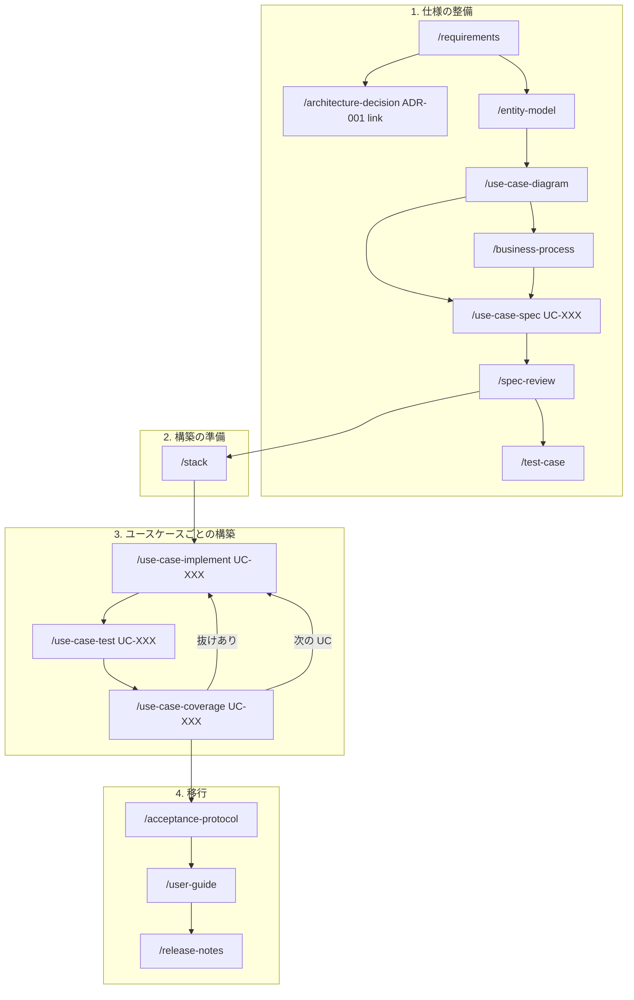

# AI Unified Process スキルの実行順序

`.claude/skills/` にコピーした AI Unified Process(aiup)のスキルを、このリポジトリで使う順番をまとめる。コピー元と、リポジトリに合わせて変えた点は `.claude/third_party/aiup/SOURCE.md` にある。

このリポジトリは aiup の流儀に従う。aiup の成果物の形式・置き場所・ID は、AGENTS.md の「aiup の流儀に従う」にまとめてある。

## 前提: 今の docs の状態

| aiup の成果物 | 今の状態 |
|---|---|
| `docs/vision.md`(チームが書く入力) | 置かない。代わりに [brief](../brief/index.md) の 01〜07 を入力にする |
| `docs/requirements.md`、`docs/glossary.md` | 未作成。1-1 で作る。できたら要件の正はこちら |
| `docs/entity_model.md`、`docs/use_cases.puml`、`docs/use_cases/` | 未作成 |
| `docs/architecture/stack.md` | 未作成。2 で作る |
| `docs/architecture/decisions/` | [ADR-001](../architecture/decisions/ADR-001-multiple-drawdowns-and-loan-share-pie.md) を aiup 形式で置いた。`**Requirements:**` は空 |
| `docs/open_questions.md` | **作らない。** 仕様の未決事項は GitHub Issue(`[要確認]`)で管理する(AGENTS.md「仕様の未決事項は GitHub Issue で管理する」) |

brief の ID(`FR-01`・`BR-01`・`NFR-01`・`EX-01`)は元資料の中だけで使う。aiup の成果物では aiup の ID(`FR-001`・`UC-001` の `BR-001` など)を新たに振る。

コピーしたスキルは、`docs/architecture/stack.md` だけでなく `docs/architecture/` の下のファイルを全部(ADR も含む)読むように変えてある。書き込みは今までどおり `stack.md` だけ。

## 全体の流れ

迷ったら、いつでも `/next` を実行する。読むだけで、次に実行するコマンドとその理由を出してくれる。仕様の質問が出たら、どの段階でも GitHub Issue に `[要確認]` として起票する。`/next` は Issue を見ないので、開いている `[要確認]` の Issue も合わせて確認する。

## 1. 仕様の整備(Inception / Elaboration)

### 1-1. `/requirements` — 要件カタログと用語集

- **入力**: [brief](../brief/index.md) の 01〜07 と、GitHub Issue の `[要確認]`。`docs/vision.md` は無いので、実行するときに「`docs/brief/` を project brief として使う」と指示する。
- **出力**: `docs/requirements.md`(FR / NFR / C の表)、`docs/glossary.md`。質問が残れば `[要確認]` の Issue に起票する。
- **付加価値**: FR がユーザーストーリー形式になる。NFR に測れる閾値が付く。制約(C)が分かれる。用語集の「使わない同義語」を `/spec-review` が検査する。要件の Status がユースケースから追える。
- **Issue との対応**: 開いている `[要確認]` の Issue は Issue のまま残す。関係する FR / NFR / C / 用語が決まったら、Issue に対応する ID を書く。決着した Issue は、決定をカタログに反映して人が確認してからクローズする。
- **注意**: brief の業務ルール(`BR-xx`)はカタログに入らない。1-5 でユースケースの業務ルールになる。

### 1-2. `/architecture-decision ADR-001 link …` — ADR と要件を結ぶ

- カタログができたら、ADR-001 が支える NFR / C を `**Requirements:**` に足す。`/spec-review` は、どの要件にも結ばれていない Accepted の ADR を指摘する。
- 新しい設計判断は、この段階に限らず `/architecture-decision` で記録し、[アーキテクチャ文書 目次](../architecture/index.md) にリンクを足す。

### 1-3. `/entity-model` — エンティティモデル

- **入力**: `docs/requirements.md`、`docs/glossary.md`、[業務概要と用語](../brief/01-business-overview.md)、[Share Pie の数値例](../brief/05-share-pie-examples.md)、ADR-001。
- **出力**: `docs/entity_model.md`(Mermaid の ER 図と属性表)。
- **注意**: Facility と Loan がそれぞれ Share Pie を持つ(ADR-001)ことが反映されているか確かめる。

### 1-4. `/use-case-diagram` — ユースケース図

- **入力**: `docs/requirements.md`、[アクター・ロールと承認ワークフロー](../brief/06-actors-and-roles.md)。
- **出力**: `docs/use_cases.puml`(アクターと UC-XXX)。ここでユースケースの ID が決まる。

### 1-5. `/business-process` — 業務プロセス

- **入力**: ユースケース図、[アクター・ロールと承認ワークフロー](../brief/06-actors-and-roles.md)。
- **出力**: `docs/processes/BP-XXX-*.bpmn`。
- **理由**: 承認ワークフロー(起案 → 合議 → 承認・否決)は、複数のロールにまたがって受け渡しがある。こういう流れは BPMN にしておくと、1-8 でテストケースを経路ごとに作れる。

### 1-6. `/use-case-spec UC-XXX` — ユースケース仕様

- **入力**: ユースケース図、要件カタログ、用語集、エンティティモデル、[業務ルール](../brief/03-business-rules.md)。外部連携のユースケースは [外部システム連携](../brief/07-external-integration.md) も。
- **出力**: `docs/use_cases/UC-XXX-*.md`。1件ずつ実行する。
- **注意**: brief の `BR-xx` を、関係するユースケースの業務ルール(`BR-001` …)に割り振る。

### 1-7. `/spec-review` — 仕様の検査

- 機械的な lint(ID の重複、未カバーの FR、用語の揺れ など)と、内容のレビューをする。仕様を書き換えたら、そのたびに実行する。
- `/spec-review impact FR-001` で、変更が何に影響するかを編集の前に調べられる。

### 1-8. `/test-case` — 業務を通したテストケース

- **入力**: 仕様済みのユースケース、または `BP-XXX`。[Share Pie の数値例](../brief/05-share-pie-examples.md) の通しの例(ドローダウン → 返済 → 利息 → 手数料)は、そのままテストケースの素材になる。
- **出力**: `docs/test_cases/TC-XXX-*.md`。
- **注意**: E2E テストの層スキル(aiup-playwright など)は入れていないので、`/test-case-implement` での自動化はまだできない。

## 2. 構築の準備

### `/stack` — 層ごとのスキルの割り当て

- **入力**: `docs/architecture/` の下のファイル全部(技術スタック・設計方針・ADR)、`pom.xml`(できてから)、コピー済みの層スキル。
- **出力**: `docs/architecture/stack.md`(Layers 表、Integration layer 表、Markers 表、Module layout、API contract、Commands)。
- **今の層スキル**:

  | 層 | 作る | テスト |
  |---|---|---|
  | migration(Flyway) | `flyway-schema` | なし(永続化層のテストで確かめる) |
  | 永続化(jOOQ) | `jooq-persistence` | `jooq-persistence-test` |
  | サービス | `spring-service` | `spring-service-test` |
  | REST API | `spring-rest` | `spring-rest-test` |
  | UI(React) | なし(aiup の範囲外。下の未決事項を参照) | なし |
- **Module layout**: [設計方針](../architecture/design-principles.md) は単一モジュールの package by feature で、依存の向きは `web → ドメイン ← persistence`。`spring-service` の flat / hexagonal のどちらに当てるかを、ここで決める。

## 3. ユースケースごとの構築(UC ごとに繰り返す)

1. `/use-case-implement UC-XXX` — `stack.md` の層スキルを下の層から順に実行する(migration → 永続化 → サービス → REST)。仕様に穴があれば実装せず、質問として残す。
2. `/use-case-test UC-XXX` — Integration layer の層からテストを書く。REST API が入口なら、`spring-rest-test` が業務ルールの許可と拒否の両方を、実際のサービスと DB を通してテストする。仕様と食い違うテストは失敗のまま残す。
3. `/use-case-coverage UC-XXX` — 仕様のステップ・代替フロー・業務ルールが、コードとテストにどう対応しているかを表にする(読むだけ)。抜けがあれば 1 か 2 に戻る。

最初は、ドメインの中心で他への依存が少ないユースケース(ファシリティの組成など)から始める。

## 4. 移行(Transition)

1. `/acceptance-protocol` — 受け入れテストのチェックリストを作り、結果を記録する。全部通ったユースケースは Done になる。
2. `/user-guide` — Tested / Done のユースケースから利用者向けの手引きを書く。
3. `/release-notes` — Git タグ以降に Done になったユースケースから、業務向けのリリースノートを書く。

## 使わない・保留するスキル

| スキル | 理由 |
|---|---|
| `/reverse-engineer` | 既存のコードが無いので不要 |
| `/test-case-implement`、`/test-case-coverage` | E2E の層スキルが無い |

## 未決事項

- **フロントエンド**: 技術スタックの React(Vite + TanStack)を受け持つ aiup の層スキルは無い(aiup にあるのは Angular / Next.js / Vaadin 向けだけ)。当面、aiup の範囲は REST API までにする。UI は後で決める。案は、run-buddy と同じく API とデザイントークンを土台に作る、簡単な層スキルを自作すること。
- **`spec_lint.py` の stack.md**: `/next` と `/spec-review` が使うスクリプトは、`docs/architecture/stack.md` を決め打ちで読む。上書きルールは効かないから、層の表は `stack.md` に置く必要がある。
