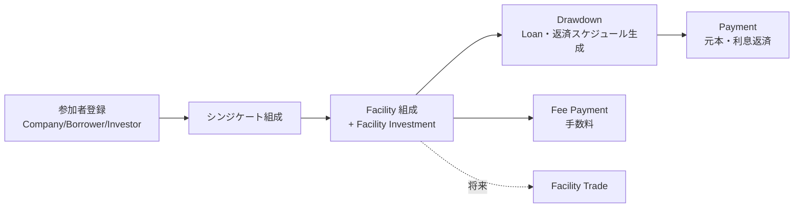

# 業務概要と用語

## 1. シンジケートローンとは

複数の金融機関(**投資家 / Investor**)が協調して、単一の企業(**借り手 / Borrower**)に大規模な融資を行う仕組み。
幹事銀行(**リード銀行**)が**シンジケート団(Syndicate)**を組成し、取引全体を調整する。
リード銀行は、資金の集中と各投資家への分配の窓口(エージェント)も担う。

本システムは、このシンジケートローンの組成から融資実行、返済、手数料の分配までを記録・管理する。

## 2. 参加者(Party)

| 用語 | 定義 |
|---|---|
| Company(企業) | 借り手・投資家が企業である場合の企業情報。 |
| Borrower(借り手) | 融資を受ける企業または個人。信用度に応じた借入可能額が設定される。 |
| Investor(投資家) | シンジケートに参加して資金を提供する金融機関など。 |
| Syndicate(シンジケート団) | 特定の Facility を共同で提供する集まり。借り手・投資家・リード銀行からなる。リード銀行は必須。 |

## 3. 主要概念

### 3.1 Position(ポジション)

特定の投資家が持つ「持ち分」や「状態」を表す基底概念。

| サブタイプ | 定義 |
|---|---|
| Facility(ファシリティ) | 借り手が資金を引き出せる融資枠(コミットメント)。 |
| Loan(ローン) | Facility から借り手が実際に引き出した資金の残高。 |

### 3.2 Transaction(取引)

金銭やポジションの移動・状態変化を記録する基底概念。特定の Position に関連付けられる。

| サブタイプ | 定義 | 資金の流れ |
|---|---|---|
| Facility Investment(ファシリティ投資) | 各投資家が Facility に提供する資金の記録。 | 投資家 → シンジケート |
| Drawdown(ドローダウン) | 借り手が Facility から資金を引き出す取引。 | シンジケート → 借り手 |
| Payment(支払い) | 借り手からシンジケートへの支払い。下記3種を含む。 | 借り手 → シンジケート → 投資家 |
| ├ Interest Payment(利息支払い) | 利息の支払い。 | 同上 |
| ├ Principal Payment(元本返済) | 元本の返済。 | 同上 |
| └ Fee Payment(手数料支払い) | 各種手数料の支払い。 | 同上 |
| Facility Trade(ファシリティ取引) | 投資家間でファシリティ/ローンの持ち分を売買する取引。 | 投資家 A → 投資家 B |

### 3.3 配分・割当

| 用語 | 定義 |
|---|---|
| Share Pie(シェアパイ) | Position(Facility/Loan)に対する各投資家の持分比率。 |
| Amount Pie(金額パイ) | Transaction における各投資家への金額配分。Share Pie に基づいて計算されることが多い。 |
| Payment Distribution(支払配分) | Payment における各投資家への返済配分(元本・利息別)。 |
| Fee Distribution(手数料配分) | Fee Payment における受益者への配分。 |

### 3.4 投資額管理

| 用語 | 定義 |
|---|---|
| Current Investment Amount(現在投資額) | 各投資家の現在の実投資額。 |

- 増加: Drawdown 実行時に Amount Pie の金額分が加算される。
- 減少: Payment 実行時に Payment Distribution の**元本分のみ**が減算される。
- 利息は投資額に影響せず、投資家の収益として扱う。

## 4. その他の関連概念

- **Currency(通貨)**: 取引・金額の通貨。
- **Fee Type / Transaction Type**: 手数料・取引の分類マスタ。
- **Money / Percentage**: 金額(通貨付き、精度保証)と比率を表す共通の値概念。

## 5. 主要業務プロセスの全体像

各プロセスの詳細は [機能要件](02-functional-requirements.md) を参照。

## 6. 出典と裏取り状況

本ドメインは、Eric Evans『Domain-Driven Design』第8章「Breakthrough(突破)」のシンジケートローンの例(Share Pie)を土台にしている。
章の本文(英語原文を転載したページ)と、Nick Tune の解説記事を読み、ddd-ai 由来の要件と突き合わせた。以下は本文の要約であり、引用ではない。

### 書籍が述べていること

1. **Facility と Loan**: Facility は「貸す約束(コミットメント)」であり、クレジットカードの限度額にたとえられる。引き出し(drawdown)のたびに未返済の Loan が増える。Facility を維持する対価の手数料は、Loan とは独立に発生する。
2. **当初のモデルの問題**: Loan Investment を「Facility 持分に比例する派生物」とし、実際の拠出が持分とずれる場合を Loan Adjustment で補った。しかし、端数(丸め)の不整合が複雑なアルゴリズムでも消えなかった。銀行は1円の端数まで正確に会計できないソフトを信用しない。
3. **突破**: **Facility の持分と Loan の持分は、互いに独立して変わりうる。** 「Investment」「Loan Investment」は、より一般的な「持分(Share)」の特殊ケースだった。Facility の持分、Loan の持分、支払配分の持分は、すべて **Share Pie** で表せる。持分の合計や手数料配分などの正当な制約は保ったまま、Loan の Share Pie を直接調整できるようになり、Loan Adjustment は不要になった。Loan Investment は銀行の用語ではなく、業務の専門家にも通じていなかった。
4. **シナリオ(数値例)**:
   - Facility は $100MM のコミットメント。借り手が最初に $50MM を引き出すと、3社の貸し手は Facility 持分どおりに拠出する。
   - 続く $30MM の引き出しでは、貸し手 B が参加せず、A が多く拠出する。Loan の残高は $80MM(Facility 上限内)になり、**Loan の持分は Facility の持分と比例しなくなる**。これは普通のことである。
   - **元本の返済と利息の支払い**は、Facility ではなく、**Loan の持分**で貸し手に配分する。
   - **手数料(Facility を利用可能にしておく対価)**は、実際に貸したかどうかによらず、**Facility の持分**で配分する。Loan は変化しない。
   - 利息の持分と手数料の持分を、貸し手どうしが別々に取引する場面もある。
5. **効果**: 想定外の要件変更が止まり、丸め処理が安定した。Share Pie は「Share の計算(shares math)」を簡潔にし、アプリ全体の共通言語になった。
6. **後日談(エピローグ)**: Facility と Loan に引き出し・手数料支払いなどの規則が詰め込まれていた。そこで「Transaction(金融取引)」を明示の概念とし、Facility と Loan を **Position** として抽象化した(Figure 8.9)。取引ごとの規則・交渉・承認を、簡潔に書けるようになった。

### 本文書(ddd-ai 由来)との突き合わせ

| 論点 | 書籍 | 本文書 | 判定 |
|---|---|---|---|
| Position / Transaction の構造 | エピローグで導入 | 3.1, 3.2 | **一致**(ddd-ai はこの構造を採用) |
| Share Pie を支払配分にも使う | 持分は Facility・Loan・支払配分に共通 | Amount Pie / Payment Distribution / Fee Distribution を別名で定義 | 概念は一致。名前の統一は未決 |
| 引き出し時の配分 | 貸し手は持分どおりとは限らず、辞退・増額がある | FR-04: Share Pie に基づく自動計算。明示指定も可能 | **一致**(ただし、明示指定時に合計=引出額の検証を要件にする) |
| **同一 Facility への複数回の引き出し** | 可能。$50MM → $30MM と引き出し、Loan 残高は $80MM になる | BR-21: 最初のドローダウンで Facility を FIXED にし、2度目を**禁止** | **不一致**(下記) |
| **Loan の持分** | Loan 自身が Share Pie を持ち、引き出しのたびに変わる | Loan は引き出しごとに作られ、配分は引き出し時の Amount Pie で固定 | **不一致**(下記) |
| 元本・利息の配分 | Loan の持分で配分 | BR-12: ドローダウン時の Amount Pie で配分 | Loan が1回の引き出しに対応する限り同等。複数回の引き出しを許す場合は Loan の持分での配分が必要 |
| 手数料の配分 | Facility の持分で配分 | BR-43: コミットメント・遅延のみ Share Pie。他は単一受益者 | 差異あり(下記) |
| 丸め | 端数を正確に会計。Share Pie で解消 | BR-32, NFR-01 | 一致 |
| 用語 | 「Loan Investment」は銀行用語ではない | 使っていない。ただし「Facility Investment」は ddd-ai の独自語 | 要確認 |

### 不一致と差異(要確認)

1. **複数回のドローダウン**: 書籍は、1つの Facility に対し複数回の引き出しを許し、Loan 残高が増えていくモデルである。ddd-ai の「最初のドローダウンで FIXED にして2度目を禁止する」規則は、書籍の例と合わない。実務(例: 限度額内での繰り返しの引き出し)からも不自然である。**BR-21 を見直す**ことを推奨する。見直す場合、FIXED の意味(持分の変更禁止のみとするか)を決める。
2. **Loan の持分**: 書籍どおり Loan が Share Pie を持つ設計にすると、複数回の引き出しや、返済時の Loan 持分での配分が素直に表せる。ddd-ai は引き出しごとに Loan を作る簡略化をしている。どちらにするかは [設計方針](../arch/design-principles.md) の集約の決定と合わせて決める。
3. **手数料**: 書籍の手数料は、Facility を利用可能にしておく対価で、Facility の持分で配分する。コミットメント手数料はこれに当たる。管理・アレンジメント・エージェント手数料を単一の受益者に払うのは、書籍にはない ddd-ai の具体化で、特定の役割(リード銀行)への報酬という別の性質のものと読める。
4. **持分の取引**: 書籍は、利息の持分と手数料の持分を別々に取引する場面があると述べる。FR-10 の設計では、持分の種類(Facility / Loan / 手数料 / 利息)ごとの取引を考慮する。

### 参照元

- Eric Evans, *Domain-Driven Design: Tackling Complexity in the Heart of Software*, Chapter 8 "Breakthrough"。原文の転載ページ: [imapai.github.io/Domain-Driven-Design-zh/ch8.html](https://imapai.github.io/Domain-Driven-Design-zh/ch8.html)(中国語訳サイト内の英語本文。図は未確認で、本文中の図の説明に基づく)
- Nick Tune, [Share Pie: The DDD Treasure Hidden in Plain Sight](https://nick-tune-dot-me.pages.dev/blog/2021-08-14-share-pie-the-ddd-treasure-hidden-in-plain-sight)(解説。モデルの詳細は含まない)
- 未確認: 書籍の紙面の図(Figure 8.1〜8.9)そのもの。取得したのは本文テキストのみ。
