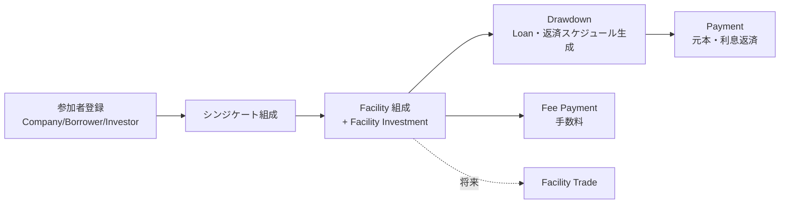

# 業務概要と用語

## 1. シンジケートローンとは

複数の金融機関(**投資家 / Investor**)が協調して、単一の企業(**借り手 / Borrower**)に大規模な融資を行う仕組み。
幹事銀行(**リード銀行**)が**シンジケート団(Syndicate)**を組成し、取引全体を調整する。
リード銀行は、資金の集中と各投資家への分配の窓口(エージェント)も担う。

本システムは、このシンジケートローンの組成から融資実行、返済、手数料の分配までを記録・管理する。

## 2. 参加者(Party)

| 用語 | 定義 |
|---|---|
| Company(企業) | 借り手・投資家が企業である場合の企業情報。 |
| Borrower(借り手) | 融資を受ける企業または個人。信用度に応じた借入可能額が設定される。 |
| Investor(投資家) | シンジケートに参加して資金を提供する金融機関など。 |
| Syndicate(シンジケート団) | 特定の Facility を共同で提供する集まり。借り手・投資家・リード銀行からなる。リード銀行は必須。 |

## 3. 主要概念

### 3.1 Position(ポジション)

特定の投資家が持つ「持ち分」や「状態」を表す基底概念。

| サブタイプ | 定義 |
|---|---|
| Facility(ファシリティ) | 借り手が資金を引き出せる融資枠(コミットメント)。 |
| Loan(ローン) | Facility から借り手が実際に引き出した資金の残高。 |

### 3.2 Transaction(取引)

金銭やポジションの移動・状態変化を記録する基底概念。特定の Position に関連付けられる。

| サブタイプ | 定義 | 資金の流れ |
|---|---|---|
| Facility Investment(ファシリティ投資) | 各投資家が Facility に提供する資金の記録。 | 投資家 → シンジケート |
| Drawdown(ドローダウン) | 借り手が Facility から資金を引き出す取引。 | シンジケート → 借り手 |
| Payment(支払い) | 借り手からシンジケートへの支払い。下記3種を含む。 | 借り手 → シンジケート → 投資家 |
| ├ Interest Payment(利息支払い) | 利息の支払い。 | 同上 |
| ├ Principal Payment(元本返済) | 元本の返済。 | 同上 |
| └ Fee Payment(手数料支払い) | 各種手数料の支払い。 | 同上 |
| Facility Trade(ファシリティ取引) | 投資家間でファシリティ/ローンの持ち分を売買する取引。 | 投資家 A → 投資家 B |

### 3.3 配分・割当

| 用語 | 定義 |
|---|---|
| Share Pie(シェアパイ) | Position(Facility/Loan)に対する各投資家の持分比率。 |
| Amount Pie(金額パイ) | Transaction における各投資家への金額配分。Share Pie に基づいて計算されることが多い。 |
| Payment Distribution(支払配分) | Payment における各投資家への返済配分(元本・利息別)。 |
| Fee Distribution(手数料配分) | Fee Payment における受益者への配分。 |

### 3.4 投資額管理

| 用語 | 定義 |
|---|---|
| Current Investment Amount(現在投資額) | 各投資家の現在の実投資額。 |

- 増加: Drawdown 実行時に Amount Pie の金額分が加算される。
- 減少: Payment 実行時に Payment Distribution の**元本分のみ**が減算される。
- 利息は投資額に影響せず、投資家の収益として扱う。

## 4. その他の関連概念

- **Currency(通貨)**: 取引・金額の通貨。
- **Fee Type / Transaction Type**: 手数料・取引の分類マスタ。
- **Money / Percentage**: 金額(通貨付き、精度保証)と比率を表す共通の値概念。

## 5. 主要業務プロセスの全体像

各プロセスの詳細は [機能要件](02-functional-requirements.md) を参照。
